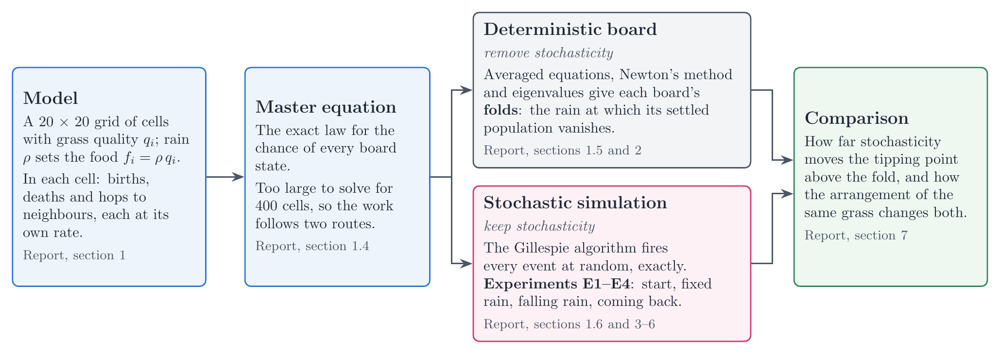
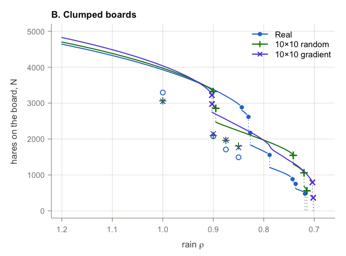
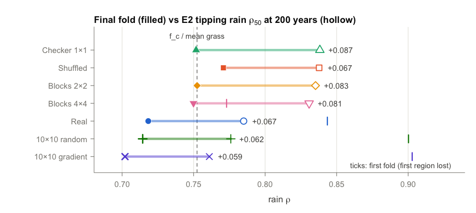
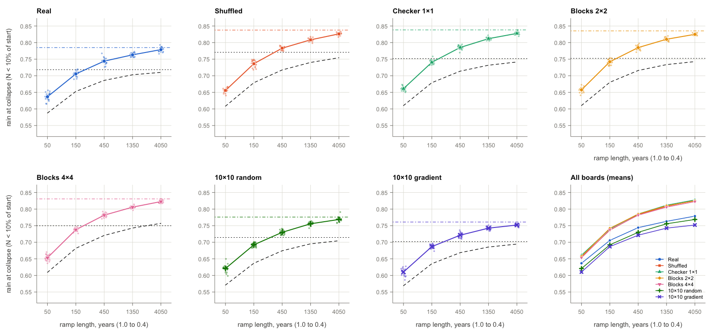
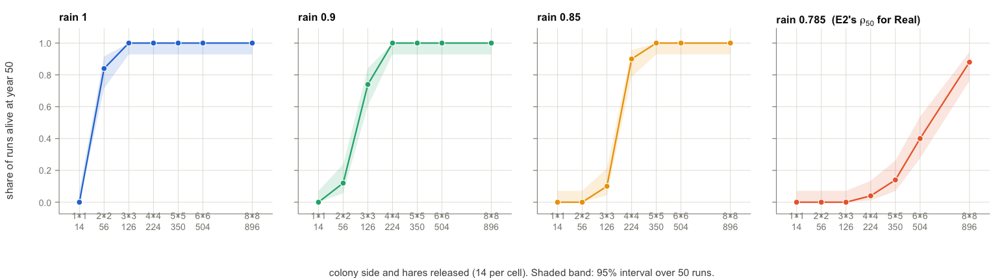
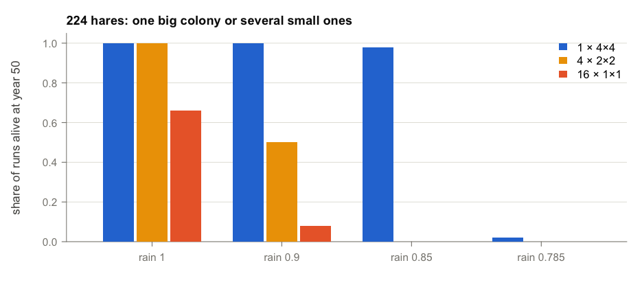

# Hopping-Hares

### *A stochastic, spatial, finite-population model*

Many animals select better habitat, so the arrangement of habitat, and
not only its total amount, can shape how a population responds when the
environment deteriorates. This project asks how the spatial arrangement
of the same habitat changes the point at which a finite population tips
to extinction, and how far demographic stochasticity moves that point
away from the deterministic prediction.

This page gives a short overview. The full report,
[REPORT.md](REPORT.md), contains the theory, the methods and all four
experiments.

------------------------------------------------------------------------

## The model

Hares live on a $20\times 20$ grid of cells. Each cell $i$ has a grass
quality $q_i \in [0, 1]$, and rain $\rho$ sets its food,
$f_i = \rho\,q_i$ ($\rho = 1$ is a normal year). Only four events change
the count $n_i$: a birth, which needs a partner, food and free room; a
death; a hop out to a neighbouring cell; and a hop in from one. Hares
accept hops toward greener cells more often. Each event fires at random
at its own rate, so the board is a continuous-time Markov chain
([report, sections 1.1 and 1.4](REPORT.md#s1-1)).

<figure>


<figcaption aria-hidden="true">

The model in one picture: a 5 by 5 piece of map and the chance of each
event in a short time dt

</figcaption>

</figure>

Default parameters: $b_0 = 4$, $h = 2$, $K = 20$, $\mu = 1$, $m = 10$,
$\alpha = 2$.

## Seven landscapes from one map

The Real board covers a $10\times 10$ km window around the Mayureshwar
Wildlife Sanctuary near Pune, built from the ESA WorldCover 2021
land-cover map. Six more boards rearrange the same 400 grass values,
from fine mixtures (Shuffled, Checker $1\times 1$, Blocks $2\times 2$)
to large blocks (Blocks $4\times 4$ and two boards of $10\times 10$
quadrants). Every board holds the same grass, so any difference between
them comes from the arrangement alone.


The same 400 grass values in seven arrangements. Darker green is better
grass.

## Approach

<figure>



<figcaption aria-hidden="true">

Approach: the model leads to the master equation, which splits into the
deterministic board and the stochastic simulation; both feed the
comparison

</figcaption>

</figure>

The master equation describes the model exactly, but a board has more
than $21^{400}$ states, so the project follows two routes. The averaged
equations remove stochasticity and give each board’s folds; exact
stochastic simulations with the Gillespie algorithm show where finite
populations actually collapse. Comparing the two routes separates the
effect of stochasticity from the effect of arrangement. The step-by-step
chart of the whole project is in [report section 1.3](REPORT.md#s1-3).

## Results

### 1. Without stochasticity, arrangement moves the fold

In the averaged equations every board keeps a settled population until
the rain falls to its final fold, between 0.702 ($10\times 10$ gradient)
and 0.771 (Shuffled). Fine boards lose almost all their hares at one
fold. Clumped boards lose them in steps, poor regions first, and hold on
in their good blocks: the Real board passes eight folds between rain
0.844 and 0.718.



Hares on the settled board as rain falls (wet on the left). Filled
markers: folds; dotted lines: the drop at each fold. Hollow markers: the
mean of the stochastic simulations, always lower.

### 2. Stochasticity tips every board above its fold (E2)

At fixed rain, the tipping rain $\rho_{50}(200)$, at which half the runs
lose every hare within 200 years, lies 0.06–0.09 above the deterministic
fold on every board. Fine boards tip at 0.831–0.838 and clumped boards
at 0.761–0.785, so the arrangement of the same grass moves the tipping
rain by about 0.08. Stochasticity therefore widens the difference
between fine and clumped boards that the folds already show.



Filled: deterministic final fold. Hollow: $\rho_{50}$ at 200 years.
Number: the gap that stochasticity adds. Ticks: the first fold of the
clumped boards.

### 3. The speed of a drought decides between lag and stochasticity (E3)

When rain falls in a straight line from 1.0 to 0.4 over 50 to 4,050
years, the collapse rain rises with the length of the ramp on every
board (Shuffled: 0.656 on the 50-year ramp, 0.826 on the 4,050-year
ramp). Fast droughts carry boards far below their fold before the hares
can respond (lag). Slow droughts give stochasticity time: on the
4,050-year ramp, boards collapse about 0.01 below E2’s tipping rain. The
collapse rain crosses the deterministic fold between the 150- and
450-year ramps on every board, and the ranking of the boards holds at
every speed.



Collapse rain (the rain at which fewer than 10% of the starting hares
remain) against ramp length. Dots: single runs; coloured line: their
mean. Dashed black: the deterministic board on the same ramp. Dotted
black: the deterministic fold. Dash-dot: E2’s $\rho_{50}(200)$.

### 4. Coming back is harder than staying (E4)

On an empty Real board, a released colony of full cells (14 hares each)
must be a compact block to persist for 50 years. The smallest block that
survives in at least half of 50 runs grows from $2\times 2$ cells at
rain 1.0 to $3\times 3$ at 0.9, $4\times 4$ at 0.85 and $8\times 8$ at
0.785, the Real board’s tipping rain. A single cell never takes hold.
With 224 hares, one $4\times 4$ colony does at least as well as four
$2\times 2$ colonies or sixteen single cells at every rain, and far
better as rain falls (at rain 0.85: 49 of 50 runs alive, against 0 and
0), although the scattered cells sit on better grass.



Share of 50 runs alive at year 50 against colony size, at four rains.



224 hares as one $4\times 4$ colony, four $2\times 2$ colonies or
sixteen single cells.

## Open questions

1.  **Barrier and population size.** If a population of $N$ hares lasts
    about $e^{N\cdot S}$ years, does a larger barrier per hare $S$ on
    clumped boards explain why they tip closer to their fold, and does
    the ranking of the boards survive larger populations ($K = 40$ and
    $80$)?
2.  **Spatial early warning signals.** On slow droughts, do variance,
    autocorrelation and spatial correlation (Moran’s $I$) of the
    simulated boards rise before collapse?
3.  **Hysteresis.** When rain returns after a partial collapse, at what
    rain and how fast do the refuges refill the board, and does the
    arrangement that delays collapse also speed recovery?

## Running the code

``` r
source("Load.R")                 # load every function; run from this folder
E2_fold_gap_plot()               # every figure has a nickname with no input
source("checks/Run_checks.R")    # 28 checks; each prints PASS
```

- **Requirements.** Base R (4.1 or newer). An optional C engine,
  compiled on first use, makes the simulations about 100 times faster;
  it needs a C compiler (Rtools on Windows, the Xcode command line tools
  on a Mac).
- **Rerunning an experiment.** Each file in `run/` starts with
  `quick = TRUE`, a small version that writes to `results_quick/`; set
  `quick = FALSE` for the full design, which rewrites `results/`. Run E1
  before E2 and E3, which start from its boards.
- **Figures.** Knit `README.Rmd` or `REPORT.Rmd` to redraw every figure
  from `results/`.
- **More.** [Report section 9](REPORT.md#s9) lists every file, and
  [section 10](REPORT.md#s10) describes how I used AI in this project.
