# Hopping-Hares

### *A stochastic, spatial, finite-population model*

*The full report. For a short overview, see [README.md](README.md).*

Evolution has gifted animals with different survival strategies, and
many species, which we call habitat selectors, actively choose better
habitat where they can leverage these strategies to maximise their
survival. In the modern world, habitat loss is one of the major issues
in wildlife conservation. The problem has multiple dimensions: living
organisms adapt to the ecosystems they live in, and the ecosystems
select them in turn, so there is a feedback loop at work, which makes
this a truly complex problem. From the perspective of population
dynamics, an elementary question follows: how do different spatial
structures of suitable habitat affect population dynamics?

In this repository, I have tried to build and analyse a simple
single-species stochastic model of a finite population to study
different aspects of tipping points in the population. I named this repo
“Hopping Hare” because the Indian black-naped hare initially inspired
some assumptions and parameters, though I eventually changed many of
them. I shall no longer claim that this is about real-world population
simulation; it is a theoretical and computational enquiry in the large,
computationally irreducible ocean of population dynamics.

To model spatial structure, I created a square-grid landscape from a
satellite-based land-cover map (ESA WorldCover 2021) of the Mayureshwar
grasslands near Pune, Maharashtra, in which each square patch (cell) has
a quality index $q_i$ from 0 to 1. I then created multiple landscapes
from different rearrangements of these patches, changing nothing but the
positions of the patches. Some prominent results emerge from this. One
of the more interesting outcomes is that abundance and resilience pull
in opposite directions. Mixed, shuffled landscapes support more hares
while rain is moderate, yet they tip at a wetter rain and collapse
sharply, so a healthy-looking population can sit close to a cliff edge.
In connected, compact habitat the decline is gradual, which gives a
visible warning before the population is lost. Stochasticity makes these
differences more pronounced: because the population is finite, random
fluctuations can push it past its tipping point earlier than the
deterministic picture suggests, and spatial arrangement appears to
decide how much that matters. Finally, the poor and good cells do not
act independently. Poor cells can drain the population through
dispersal, while good cells can rescue neighbouring ones, so who sits
next to whom shapes persistence: rearranging the same habitat shifts the
tipping rain by about 0.08, roughly what a tenth less food everywhere
would do. The sections below discuss this in detail.

One thing I would like to highlight is that I did many experiments here
in the spirit of finding patterns and the underlying mechanisms of the
model, i.e. what makes something do something. The claims I make might
therefore not be exact, as limited experiments may have missed
something.

------------------------------------------------------------------------

## Index

- [**Chapter 1: Theory**](#ch1)
  - [1. The model, from rules to simulation](#s1): [1.1 Rules](#s1-1),
    [1.2 Landscapes](#s1-2), [1.3 Project Summary](#s1-3), [1.4 Master
    Equation](#s1-4), [1.5 Average structure: the deterministic
    form](#s1-5), [1.6 The Gillespie algorithm](#s1-6)
  - [2. Deterministic folds](#s2): [2.1 One cell case](#s2-1), [2.2
    Seven Landscapes](#s2-2), [2.3 Where a board collapses
    first](#s2-3), [2.4 Recovery slows before every fold](#s2-4), [2.5
    Hopping cuts both ways](#s2-5)
- [**Chapter 2: Experiments**](#ch2)
  - [3. E1. Start: how every run begins](#s3)
  - [4. E2. Fixed rain: where does each board tip?](#s4)
  - [5. E3. Falling rain: does the speed of the drought matter?](#s5)
  - [6. E4. Coming back: how big must a released colony be?](#s6)
  - Each experiment has the same five parts: Goal and general idea,
    Setup, Results, Conclusions, Problems and limitations.
- [**Chapter 3: Conclusions**](#ch3)
  - [7. Final verdict](#s7)
  - [8. Further directions](#s8)
- [**Appendix**](#app)
  - [9. The code in this folder](#s9)
  - [10. AI use](#s10)

## Reading map

This page is long. The [README](README.md) gives a short overview;
within this page, three ways through it:

> **Quick tour, little maths.** The introduction above, [1.1
> Rules](#s1-1) (read the list of events, skip the formulas), [1.2
> Landscapes](#s1-2), [1.3 Project Summary](#s1-3) and [7. Final
> verdict](#s7).
>
> **The main results.** [2.2 Seven Landscapes](#s2-2), then the Results
> part of each experiment: [4.3 E2](#s4-3), [5.3 E3](#s5-3) and [6.3
> E4](#s6-3). Finish with [8. Further directions](#s8).
>
> **The full method.** [1.4 Master Equation](#s1-4), [1.5 Average
> structure](#s1-5), [1.6 The Gillespie algorithm](#s1-6), the rest of
> [2. Deterministic folds](#s2), [3. E1](#s3) (how every run starts) and
> [9. The code in this folder](#s9).

------------------------------------------------------------------------

<a name="ch1"></a>

# Chapter 1: Theory

<a name="s1"></a>

## 1. The model, from rules to simulation

<a name="s1-1"></a>

### 1.1 Rules

> 1.  We divide the landscape into a square grid; each cell $i$ has a
>     quality index $q_i \in [0, 1]$.
>
> 2.  Each cell $i$ contains $n_i \in \mathbb{N}$ hares.
>
> 3.  Any cell has at most 4 neighbours: the adjacent cells above,
>     below, left and right.
>
> 4.  Only 4 events can happen in any cell $i$:
>
>     - Birth: $n_i \rightarrow n_i +1$.
>
>     - Death: $n_i \rightarrow n_i - 1$.
>
>     - Hop in $(j \rightarrow i)$ **:** $n_i \rightarrow n_i +1$,
>       $n_j \rightarrow n_j - 1$.
>
>     - Hop out $(i \rightarrow j)$ **:** $n_i \rightarrow n_i - 1$,
>       $n_j \rightarrow n_j + 1$.
>
> 5.  Each event has a rate (per year) as below:
>
>     - Birth rate in cell $i$:
>
>       $$B_i(n) = b_0 \times f_i \times \varphi(n) \times s(n) \times n$$
>
>       - $b_0 := \text{intrinsic per capita birth rate (per year)}$
>
>       - $f_i = \rho q_i := \text{food in cell } i,$
>
>         $\rho := \text{rain value, this is the control parameter.}(\rho = 1 \text{ is normal rain.})$
>
>       - $\varphi(n)= \dfrac{n-1}{n-1+h}:= \text{mate-finding chance; a single hare cannot breed}$
>
>         $h := \text{partner constant.}$  
>         $(\text{number of hares needed around a hare for it to find a partner half the time.})$
>
>       - $s(n)= \max \left( 0, 1-\dfrac{n}{K} \right) := \text{fraction of the free space in the cell.}$
>
>         $K := \text{the most hares a cell can support by breeding}$  
>         $\text{(it slows births as the cell fills and stops them at } K\text{. If hopping pushes } n \text{ above } K \text{, } s \text{ stays at 0.)}$
>
>     - Death rate in cell $i$:
>
>       $$D_i(n) = \mu n$$
>
>       - $\mu := \text{deaths per hare per year, constant throughout}$
>
>     - Hop rate from cell $i$ to cell $j$:
>
>       $$H_{i\to j} = \frac{m}{4} a_{ij} n_i,\qquad a_{ij} = \dfrac{q_j^{\alpha}}{q_i^{\alpha}+q_j^{\alpha}}$$
>
>       - $m := \text{number of hop tries per hare per year, a quarter toward each side}$
>
>       - $a_{ij} := \text{the crossing chance from cell } i \text{ into cell } j$
>
>       - $\alpha : = \text{ pickiness: how strongly a hare prefers better grass}$  
>         $(\text{e.g. } \alpha=0 : \text{each hop has probability } \frac{1}{2} \text{, independent of cell quality; no pickiness for any cell.})$

<figure>
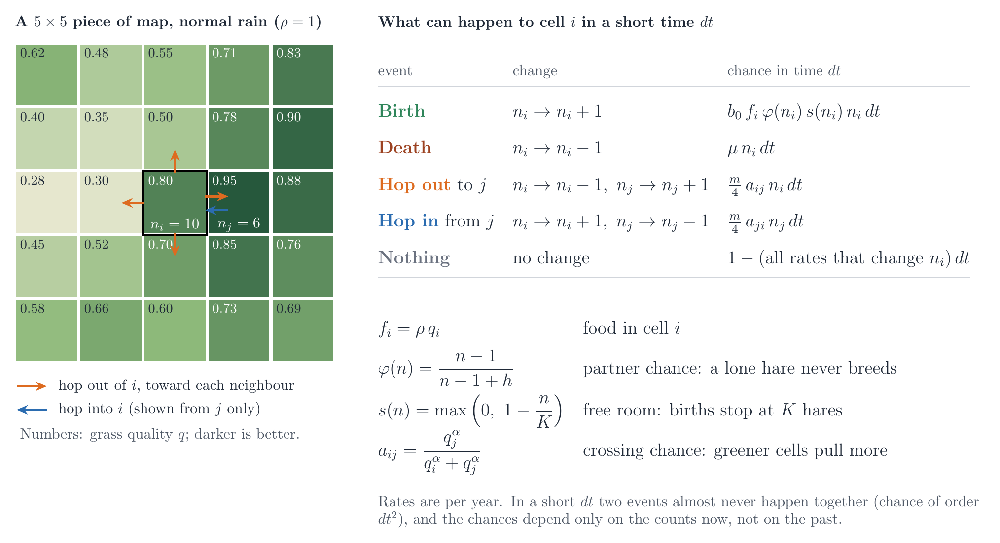
<figcaption aria-hidden="true">Demo grid (drawn with TikZ:
figs/m1_demo_grid.tex)</figcaption>
</figure>

> #### Default parameters: $b_0 = 4$, $h = 2$, $K = 20$, $\mu = 1$, $m = 10$, $\alpha = 2$.

> **Note:**
>
> - **Room caps a cell.** Births stop at $K = 20$ hares.
>
> - **Partners make small groups weak.** A lone hare never breeds
>   ($\varphi(1)=0$); with 5 hares, $\varphi = 4/6$. This is an Allee
>   effect: below a few hares a cell shrinks even on rich grass.
>
> - **Picky hops pull hares toward good grass.** From a cell with
>   $q = 0.80$, a try toward $q = 0.95$ succeeds with chance 0.59,
>   toward $q = 0.30$ only 0.12. A try across the map’s edge fails and
>   the hare stays.
>
> - **What we assume.** Hares find partners only inside their own cell;
>   all hares are alike (no ages, sexes or seasons); rain is the same in
>   every cell; hares do not eat the grass down; roads and the village
>   do not matter.
>
> - **The empty board is an absorbing state.** Once the population hits
>   zero, it does not come back.

------------------------------------------------------------------------

<a name="s1-2"></a>

### 1.2 Landscapes

For the rest of the project, I use 7 rearranged boards to roughly
compare population dynamics across different landscapes. Each rearranged
board keeps the same $q_i$ cells and changes only where it sits, so any
difference in how the hare population changes comes from layout alone.

Note: Hops link each cell to its neighbours, so the arrangement of grass
enters the equations. If we set $m = 0$, no hops happen, and all boards
give the same results.

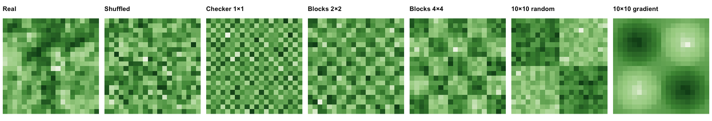

The same 400 grass values in seven arrangements. Darker green is better
grass.

> **Real board:** it is a $10\times 10$ km window around Mayureshwar
> Wildlife Sanctuary near Pune (74.32–74.42 E, 18.29–18.38 N), cut into
> a $20\times 20$ grid of 500 m cells.
>
> - Land cover from the ESA WorldCover 2021 map, which classifies
>   satellite images into 10 m pixels. Each class gets a score:
>   grassland 1.0, shrubland 0.6, cropland 0.5, trees 0.3, bare 0.2.
>
> - **Cell quality** $q$: area-weighted mean of pixel scores per 500 m
>   cell.
>
> - Improvisation: I ignored 1 village cell and set its $q$ to the mean
>   $q$ of the board.
>
> - We created a $20\times 20$ CSV of $q$; range 0.31–0.96, mean 0.66.

> Rearranged boards:
>
> **Shuffled:** the same $q$ values as the Real board, in random places.
>
> **Checker** $1\times 1$: good and poor cells alternate, so patches are
> smaller than the average distance a hare travels (1–2 cells) in its
> lifetime (w.r.t. default parameters).
>
> **Blocks** $2\times 2$: blocks of $2\times 2$ cells alternate good and
> poor like a chessboard. Good blocks take the best 200 values, poor
> blocks the rest, in random order within each kind.
>
> **Blocks** $4\times 4$: the same with $4\times 4$ blocks.
>
> $10\times 10$ random: four $10\times 10$ quadrants, good top-left and
> bottom-right; the values sit in random places inside each quadrant.
>
> $10\times 10$ gradient: the same quadrants; the grass is best at the
> centre of each good quadrant, worst at the centre of each poor one,
> and changes smoothly in between.

------------------------------------------------------------------------

<a name="s1-3"></a>

### 1.3 Project Summary

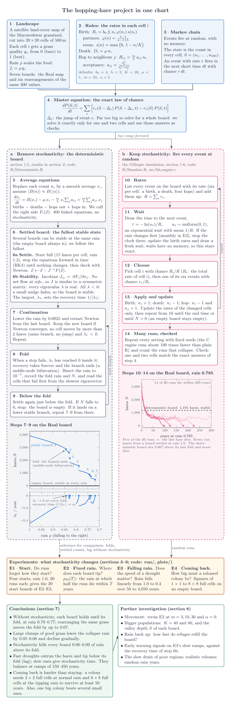

------------------------------------------------------------------------

<a name="s1-4"></a>

### 1.4 Master Equation

Births, deaths and hops happen at unpredictable moments. We let every
event fire at random at its rate, with no memory: the next event in the
chain depends only on the current counts of hares in every cell. That
makes the board a **continuous-time Markov chain.**

- $\vec n = (n_1,\dots,n_{400})$: the state of the landscape, the count
  in every cell.
- $P(\vec n,t)$: the chance that the board is in state $\vec n$ at time
  $t$.
- Each event $e$ has a rate $r_e(\vec n)$
  - jump $\Delta_e$: one hare more in a cell (birth), one hare less
    (death), or one less in a cell and one more in the next cell (hop).

$$\frac{dP(\vec n,t)}{dt} = \sum_{e}\Big[ r_e(\vec n-\Delta_e) P(\vec n-\Delta_e,t) - r_e(\vec n) P(\vec n,t)\Big]$$

> **Master equation for one cell.** With births and deaths only, no hop.
>
> $$\frac{dP(n,t)}{dt} = B(n-1) P(n-1,t) + \mu (n+1) P(n+1,t) - \big[B(n)+\mu n\big] P(n,t)$$
>
> This is a system of $21$ ODEs, one for each $n = 0, 1, \dots, 20$.
>
> Solving them gives the mean life of a full cell exactly: 544 years at
> food 1.0 and 74 years at food 0.8.

> **Master equation for two cells, joined by hopping.**
>
> $$\frac{dP(n_1,n_2,t)}{dt} = B_1(n_1-1) P(n_1-1, n_2) - B_1(n_1) P(n_1,n_2) \qquad \text{birth in cell 1}$$
>
> $$+ \mu (n_1+1) P(n_1+1, n_2) - \mu n_1 P(n_1,n_2) \qquad \text{death in cell 1}$$
>
> $$+ B_2(n_2-1) P(n_1, n_2-1) - B_2(n_2) P(n_1,n_2) \qquad \text{birth in cell 2}$$
>
> $$+ \mu (n_2+1) P(n_1, n_2+1) - \mu n_2 P(n_1,n_2) \qquad \text{death in cell 2}$$
>
> $$+ H_{12}(n_1+1) P(n_1+1, n_2-1) - H_{12}(n_1) P(n_1,n_2) \qquad \text{hop from 1 to 2}$$
>
> $$+ H_{21}(n_2+1) P(n_1-1, n_2+1) - H_{21}(n_2) P(n_1,n_2) \qquad \text{hop from 2 to 1}$$

#### Master equation for whole landscape

$$\frac{dP(\mathbf n,t)}{dt} = \sum_{i}\Big[ B_i(n_i-1) P(\mathbf n-\mathbf e_i,t) - B_i(n_i) P(\mathbf n,t) \Big]$$

$$+ \sum_{i}\Big[ \mu (n_i+1) P(\mathbf n+\mathbf e_i,t) - \mu n_i P(\mathbf n,t) \Big]$$

$$+ \sum_{i} \sum_{j\in\mathcal N(i)}\Big[ H_{ij}(n_i+1) P(\mathbf n+\mathbf e_i-\mathbf e_j,t) - H_{ij}(n_i) P(\mathbf n,t) \Big]$$

> This is a system of more than $21^{400}$ ODEs, nearly impossible to
> solve even with computers. Therefore I deal with it along two paths:
> (1) the deterministic form and (2) simulation with the Gillespie
> algorithm.

------------------------------------------------------------------------

<a name="s1-5"></a>

### 1.5 Average structure: the deterministic form

We want a simplified equation that answers three questions: where does a
board settle, is that state stable, and at what rain does it vanish? So
we follow the average count of every cell.

> **One cell case:** With births and deaths only, no hop.  
>   
> Let’s track the average population count $\langle n \rangle$:
>
> $$\langle n \rangle (t) = \sum_{n = 0}^{K} n P(n, t)$$
>
> - $P(n, t) = 0$ for $n \gt K$ if we start at or below $K$.
>
> - $P(n, t)$ can only change by an amount proportional to $dt$; so
>   $P(n, t)$ is smooth.
>
> - $\langle n \rangle (t)$ is a finite weighted sum of smooth
>   functions, so it is smooth.
>
> Differentiate both sides w.r.t. $t$:
>
> $$\dfrac{d\langle n \rangle}{dt} = \sum_{n = 0}^{K} n \dfrac{d P(n, t)}{dt}$$
>
> Substitute the master equation for $\frac{dP}{dt}$ and rearrange the
> terms to get:
>
> $$\dfrac{d\langle n \rangle}{dt} = \langle B(n) \rangle - \mu \langle n \rangle$$
>
> Take the second-order Taylor expansion of $B(n)$ around
> $\langle n \rangle$ and average it:
>
> - valid as $B$ is smooth over $n \in (0, K)$ if $h \ge 1$.
>
>   $$\langle B(n) \rangle = B(\langle n \rangle) + \frac{1}{2}B'' (\langle n \rangle) \mathrm{Var}(n) + \langle R \rangle$$
>
> Therefore $\langle B(n) \rangle \approx B(\langle n \rangle)$ is valid
> when
> $\frac{1}{2}B''(\langle n \rangle) \mathrm{Var}(n) \ll B(\langle n \rangle)$.
> And we get the following equation:
>
> $$\dfrac{d\langle n \rangle}{dt} = B(\langle n \rangle) - \mu \langle n \rangle$$

**In our case this is not exactly valid, because the spread is not small
compared with the count (about 14 hares, give or take 3, at food 1.0),
especially near the tipping point, where the spread grows and reaches
the low counts where** $|B''|$ is large. But we still use it for the
rough skeleton of the model’s settled states, their stability, the folds
(tipping points). Section 2 finds them with Newton’s method and Jacobian
eigenvalues.

#### Average Deterministic Equations for whole landscape

> - Hop terms are linear w.r.t. $n_i$, so the same math as in the one
>   cell case applies.
> - Approximation assumed:
>   $\langle B(n) \rangle \approx B(\langle n \rangle)$
> - $j$ runs over its four neighbours, except the closed edges.
> - We write $x_i$ for $\langle n_i \rangle$.

$$\frac{d\langle n_i\rangle}{dt} = \underbrace{B(\langle n_i \rangle)}_{\text{births}} - \underbrace{\mu \langle n_i\rangle}_{\text{deaths}} - \underbrace{\frac{m}{4}\Big(\sum_{j}a_{ij}\Big)\langle n_i\rangle}_{\text{hops out}} + \underbrace{\frac{m}{4}\sum_{j}a_{ji} \langle n_j\rangle}_{\text{hops in}}$$

$$\frac{dx_i}{dt} = b_0 \rho q_i x_i \varphi(x_i) s(x_i) - \mu x_i - \frac{m}{4} x_i\sum_{j}a_{ij} + \frac{m}{4}\sum_{j}a_{ji} x_j$$

> Note: The averaged equations ignore stochasticity. Fokker–Planck and
> large-deviation expansions can restore it but assume large
> populations, so they break down near extinction, where counts are
> small and each jump is large next to the count. We therefore simulate
> exactly with the Gillespie algorithm.

------------------------------------------------------------------------

<a name="s1-6"></a>

### 1.6 The Gillespie algorithm

> **Waiting time for an event to happen:**
>
> - Let’s assume a single event with constant rate $r$. In every tiny
>   slice $dt$ it happens with probability $r dt$, no matter what
>   happened before.
>
> - Let $S(\tau) = P(T > \tau)$ be the probability that the waiting time
>   $T$ is *longer* than $\tau$, i.e. nothing has happened yet by time
>   $\tau$. It starts at 1 when $\tau = 0$ and decreases. Since the
>   waiting time is independent of the past:
>
>   $$S(\tau + d\tau) = S(\tau) (1-rd\tau)$$
>
>   $$\implies \frac{dS}{d\tau} = -rS \implies S(\tau) = e^{-r\tau} \implies P(T\le \tau) = 1 - e^{-r\tau}$$
>
>   $$\implies \tau \sim \mathrm{Exp}(r)$$
>
>   $$\implies \text{mean waiting time for the event to happen } = \dfrac{1}{r}$$
>
> - Note: Given that the event hasn’t happened for time $s$, the
>   probability that it does not happen for another $\tau$ is
>   $\frac{S(s + \tau)}{S(s)} = e^{-r\tau}$. This memoryless property
>   lets us restart the clock after each event.

> **The board with many events:**
>
> - a birth clock and a death clock in every cell, and two hop clocks
>   for every fence, one in each direction. Call their rates
>   $r_1, r_2, \dots$
> - Let $R = r_1 + r_2 + r_3 + \dots$
> - Events are independent, so the probability that no event happens
>   during $\tau$ is $e^{-r_1\tau}e^{-r_2\tau}\cdots = e^{-R\tau}$.
> - Therefore the mean waiting time for any event to happen is
>   $\frac{1}{R}$.
> - Event $k$ happens with probability $r_{k} d\tau$, so the probability
>   that the $k$-th event happens after the waiting time is
>   $\frac{r_k}{R}$.

#### The algorithm

> A. Set the time when the next event happens:
>
> 1.  Draw random $u_1$ uniformly from $[0, 1]$.
> 2.  Set
>     $\tau = - \dfrac{\ln(u_1)}{R} \implies \tau \sim \mathrm{Exp}(R)$
>     (This is the exact waiting time we wanted.)
>
> B. Set which event happens at $\tau$:
>
> 1.  Draw random $u_2$ uniformly from $[0, 1]$.
>
>     - We take separate $u_2$ because *when* the next event happens and
>       *which* event it is are independent.
>
> 2.  Lay the rates end to end on a ruler of length $R$, and pick event
>     $k$ where $u_2 R$ lands:
>
>     $$r_1 + \dots + r_{k-1} < u_2 R \le r_1 + \dots + r_k$$
>
> 3.  Event $k$ owns a segment of length $r_k$ out of $R$, so $u_2 R$
>     lands on it with probability $\dfrac{r_k}{R}$, as required.
>
> C. Update time:
>
> 1.  Update $t = t + \tau$
> 2.  Apply event $k$: a birth adds one hare, a death removes one, and a
>     hop moves one hare between two cells. Recompute only the rates
>     that changed (one cell for a birth or death, two cells for a hop),
>     and update $R$.
> 3.  **Repeat** until $t$ reaches the end time or no hares are left.
>
> **Note:** if $t + \tau$ would cross a rain step (monthly in E3; the
> rain never changes in E1, E2 and E4), stop at the step, update the
> rain and the rates, and draw a fresh $\tau$. This is valid because of
> the memoryless property.

> **Checks against the master equation:** We solve the master equation
> for one and two cells (`R/Measure.R`) and use the answers to test the
> simulator (`checks/Checks.R`).

------------------------------------------------------------------------

<a name="s2"></a>

## 2. Deterministic folds

<a name="s2-1"></a>

### 2.1 One cell case

> Equilibrium:
>
> - $x = 0$ is always an equilibrium, and a stable one: near zero hares
>   find almost no partners, so births per hare fall below deaths (the
>   Allee effect). In the stochastic model, zero is also absorbing: an
>   empty cell stays empty.
>
> $$\dfrac{dx}{dt} = (b_0 f \varphi(x) s(x) - \mu) x$$
>
> $$\implies \text{Equilibrium at }: b_0 f \varphi(x)s(x) = \mu$$
>
> Rearranging the terms gives the quadratic:
>
> $$x^2 - \Big(K + 1 - \frac{\mu K}{b_0f}\Big) x + K\Big(1 + \frac{\mu (h-1)}{b_0f}\Big) = 0$$
>
> Solving the quadratic gives us two equilibrium states: $x_-, x_+$. Or,
> geometrically, births per hare $g(x) = b_0 f \varphi (x) s(x)$ form a
> hill-shaped curve and deaths per hare $d(x) = \mu$ a straight line.
> Where these two curves intersect is the equilibrium state. And as we
> lower the value of $f$, the point where the intersection becomes
> unique, i.e. where the discriminant of the quadratic above is zero, is
> the tipping point. This is a saddle-node (fold) bifurcation point. We
> refer to it as a fold throughout the document.
>
> For the default parameters, the critical food value, where the system
> tips to extinction, is $f_c = 0.498$.

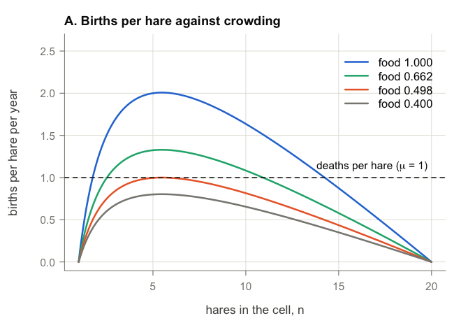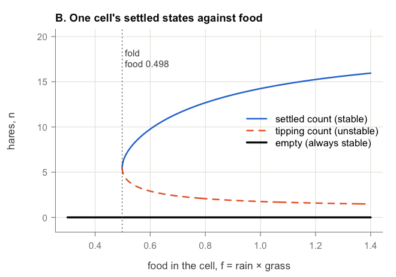

A: births per hare (the hill) against deaths per hare (the line) for
four foods. B: the settled count (blue) and the tipping count (dashed)
meet at the fold, food 0.498. The empty state (black) is stable at every
food.

------------------------------------------------------------------------

<a name="s2-2"></a>

### 2.2 Seven Landscapes

The seven boards appear in [section 1.2](#s1-2).

> **Tracking the equilibrium: Theory**
>
> $$F_i(x) = \dfrac{dx_i}{dt} = b_0 \rho q_i x_i \varphi(x_i) s(x_i) - \mu x_i - \frac{m}{4} x_i\sum_{j}a_{ij} + \frac{m}{4}\sum_{j}a_{ji} x_j$$
>
> These are 400 coupled ODEs (one per cell). Each cell can sit near
> empty or near full, so the board has many equilibria and listing them
> all is impossible. We therefore follow one branch, the fullest board,
> and track its folds.
>
> **Methodology: Newton’s method**
>
> 1.  **Baseline equilibrium:** Start with 15 hares in every cell at
>     $\rho = 1.2$. Integrate the ODEs forward in time,
>     $x(t) = x(0) + \int_0^t F(x(s))ds$, until the board settles. Then
>     refine the result with Newton’s method until all 400 rates vanish
>     $(|F| < 10^{-10}$). Confirm stability: every eigenvalue of the
>     Jacobian must be negative.
>
>     - **Integration:** fourth-order Runge–Kutta (RK4), with step
>       $dt \le 0.05$ years, short enough to stay stable with fast
>       hopping. It runs for at most 3,000 years and stops early once
>       every $|\frac{dx_i}{dt}| < 10^{-8}$. This lets the board settle
>       near the stable full state, which gives Newton a good starting
>       guess.
>
>     - **Jacobian:** $J(x)$ is a $400 \times 400$ matrix, where
>       $J_{ij} = \frac{\partial F_i(x)}{\partial x_j}$. This provides a
>       local linear approximation of $F$. Hopping satisfies detailed
>       balance $(q_i^\alpha a_{ij} = q_j^\alpha a_{ji})$, so $J$ is
>       similar to a symmetric matrix and therefore all its eigenvalues
>       are real.
>
> 2.  **Numerical continuation:** After recording the equilibrium at the
>     current $\rho$, decrease $\rho$ in steps of 0.0025, using the
>     previous equilibrium state as the starting guess for Newton.
>     Accept a step only if a. Newton converges, b. no cell moves by
>     more than 2 hares, c. all eigenvalues stay negative.
>
> 3.  **Catch the fold:** If a step fails while the leading eigenvalue
>     approaches 0, the settled board vanished inside that step. Bisect
>     the step to pin the fold rain to within $10^{-5}$.
>
> 4.  **Follow the collapse:** Integrate (RK4) for 5,000 years just
>     below the fold to see where the board lands. A **partial fold**
>     leaves some cells occupied while others empty; continue from that
>     landing board; stop if no hare is left: this is the final fold.
>
> 5.  **Track the early warning:** At each step, record
>     $\lambda_{\max}$, the eigenvalue closest to zero. The recovery
>     time, $1/|\lambda_{\max}|$, spikes near every fold (critical
>     slowing down). Its eigenvector shows which cells lose resilience
>     first: the cells that empty at that fold.

#### Results

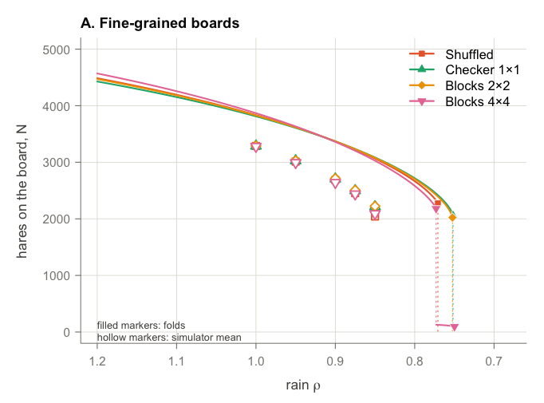

Hares on the settled board as rain falls (wet on the left). Filled
markers: folds; dotted lines: the drop at each fold. Hollow markers: the
simulator’s mean, always lower.

| Board | folds | first fold | final fold | hares just above the final fold |
|----|----|----|----|----|
| Shuffled | 1 | 0.771 | 0.771 | 2275 |
| Blocks $2\times 2$ | 1 | 0.752 | 0.752 | 2023 |
| Checker $1\times 1$ | 1 | 0.752 | 0.752 | 2057 |
| Blocks $4\times 4$ | 2 | 0.773 | 0.750 | 95 |
| Real | 8 | 0.844 | 0.718 | 479 |
| $10\times 10$ random | 5 | 0.900 | 0.714 | 559 |
| $10\times 10$ gradient | 4 | 0.903 | 0.702 | 365 |

- **The arrangement alone moves the final fold by 0.07.** Lowest on
  $10\times 10$ gradient and highest on Shuffled.
- **Fine boards collapse all at once; clumped boards collapse in
  steps.** Real loses regions eight times between 0.844 and 0.718. The
  $10\times 10$ boards lose their poor quadrants near 0.90 and their
  good quadrants at 0.70–0.74.
- **Checker** $1\times 1$ and Blocks $2\times 2$ fold at 0.752, the rain
  at which one cell with the mean grass would fold (0.498/0.662).
  Shuffled folds higher, at 0.771.

------------------------------------------------------------------------

<a name="s2-3"></a>

### 2.3 Where a board collapses first

At each fold, the slowest eigenvector of the Jacobian marks the cells
that stop recovering. On the Real board the south and the edges go first
and the grassy north holds out to 0.718. On the $10\times 10$ boards the
poor quadrants empty first.

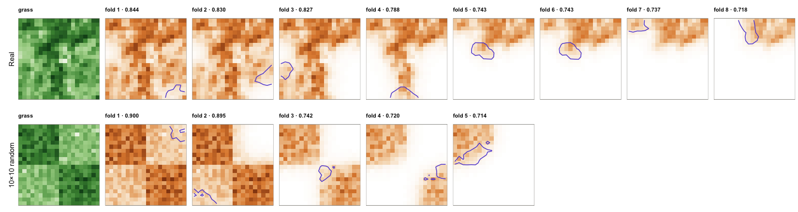

The staircase. Each map shows the settled board just above one fold; the
purple outline marks where that fold’s collapse starts.

------------------------------------------------------------------------

<a name="s2-4"></a>

### 2.4 Recovery slows before every fold

The recovery time $1/|\lambda_{\max}|$ grows as rain approaches each
fold and shoots up at the fold itself. This is critical slowing down. On
the $10\times 10$ boards it already spikes at rain 0.90, 0.2 of rain
before the final collapse.

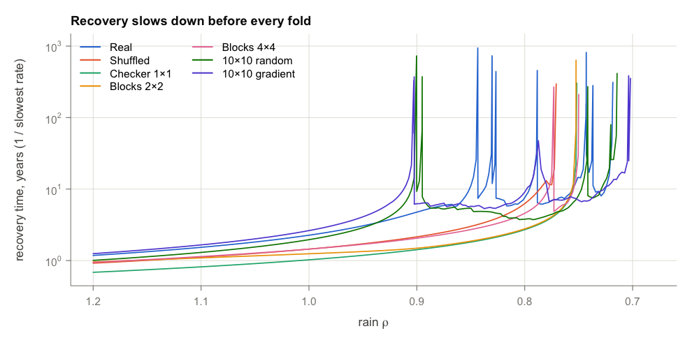

Recovery time along each board’s settled branch. Each spike is a fold.

------------------------------------------------------------------------

<a name="s2-5"></a>

### 2.5 Hopping cuts both ways

We repeated the fold search on the Shuffled board for hop rates from 1
to 400 tries a year. Slow hoppers keep their best patches longest (final
fold 0.616 at $m = 1$, from 96 small folds). Fast hoppers pool across
the board and act like one population (0.743 at $m = 400$). The default
$m = 10$ sits near the worst point (0.771): hares hop enough to leak
into poor cells, but not enough to pool.

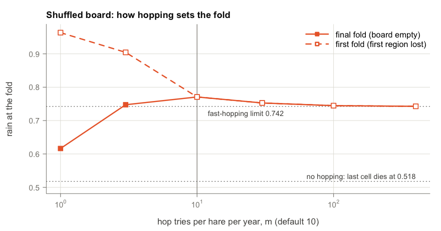

Shuffled board: final fold (solid) and first fold (dashed) against hop
rate. Dotted lines: the no-hopping and fast-hopping limits.

------------------------------------------------------------------------

<a name="ch2"></a>

# Chapter 2: Experiments

<a name="s3"></a>

## 3. E1. Start: how every run begins

<a name="s3-1"></a>

### 3.1 Goal and general idea

In experiments E2 and E3, broadly speaking, we compare how different
boards behave under different rain values, so we need to be sure that
differences come from the rain and the board, not from how we set the
board up before the experiment. One general idea could be to start every
board with equal hares in each cell, but due to the structural
differences between boards this start might favour some boards. Another
alternative could be a natural state of the board, where it no longer
remembers the $t=0$ setting. This experiment finds out what a fair start
board is for the upcoming experiments.

<a name="s3-2"></a>

### 3.2 Setup

> - Starts per cell ($x_-, x_+$: from the averaged equation for one
>   cell):
>
> - low: $x_- + 2$,
>
> - mid: $(x_- + x_+)/2 + 2$,
>
> - high: $x_+ + 2$,
>
> - random: 0–20;
>
> - 1 hare per cell (rain 0.8 only);
>
> - Rain 1.0 and 0.8; 20 runs $\times$ 50 years per start and board.
>
> - $B_r$ is the board at year 20 of the high start at rain 1.0, run
>   $r$. We use these as the start boards of E2 and E3.
>
> - Deterministic reference: the same starts in the averaged equations.

The seven boards appear in [section 1.2](#s1-2).

<a name="s3-3"></a>

### 3.3 Results

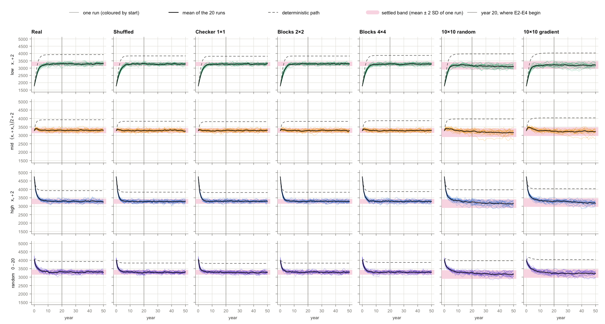

*Rain 1.0, every run. Rows: the four starts; columns: the seven boards.
Thin coloured lines: the 20 runs; black: their mean; dashed: the
deterministic path from the same start; pink band: settled level*
$\pm 2$ SD of one run; grey line: year 20.

- **Every run settles, and none dies.** All 560 runs at rain 1.0 are
  alive at year 50. Each run enters the settled band within 10 years:
  the mid start begins inside it, the others take a median 2–6 years.
- **Single runs wobble; their mean does not.** The spread of single runs
  is about 70–80 hares (1 SD) on the first five boards and about 125 on
  the $10\times 10$ boards, whose band also takes in their slow drain.
- **The** $10\times 10$ boards show the drain run by run. Four of their
  160 runs fall below the band by years 40–50. In each, a poor quadrant
  has lost about a third or more of its hares.

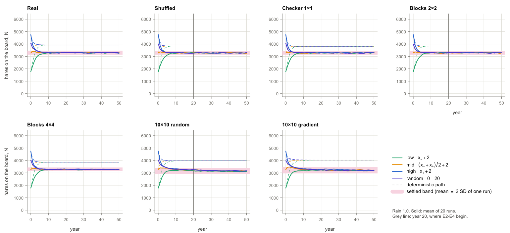

Rain 1.0. Solid: mean of 20 runs per start. Dashed: the deterministic
path from the same start. Pink band: settled level $\pm 2$ SD of one
run.

- **All four starts meet within about 10 years.** The low start climbs,
  the high and random starts fall, and the mid start overshoots slightly
  and settles.
- **They meet below the deterministic level.** The simulated boards
  settle at 3,155–3,293 hares, the deterministic ones at 3,812–4,036:
  stochasticity costs a sizeable share of the hares even in a normal
  year.

**Years to forget the start (rain 1.0).** Each start column gives the
year from which that start’s 20-run mean stays inside the noise band (2
standard errors of the settled level) for 5 years in a row.
Deterministic: the range over the four starts of the years until the
deterministic path stays within 1% of its settled level. Settled $N$:
hares on the board, the mean of years 30–50 over all 80 runs, and the
deterministic settled count.

| Board | low start | mid start | high start | random start | deterministic | settled $N$ | deterministic $N$ |
|----|----|----|----|----|----|----|----|
| Real | 12 | 4 | 9 | 20 | 4–7 | 3293 | 3926 |
| Shuffled | 10 | 4 | 6 | 9 | 3–6 | 3282 | 3834 |
| Checker $1\times 1$ | 10 | 2 | 6 | 9 | 3–6 | 3283 | 3812 |
| Blocks $2\times 2$ | 7 | 4 | 6 | 5 | 3–6 | 3290 | 3828 |
| Blocks $4\times 4$ | 11 | 5 | 5 | 7 | 3–7 | 3285 | 3868 |
| $10\times 10$ random | 5 | 24 | 24 | 26 | 4–8 | 3155 | 3973 |
| $10\times 10$ gradient | 7 | 18 | 33 | 16 | 3–10 | 3213 | 4036 |

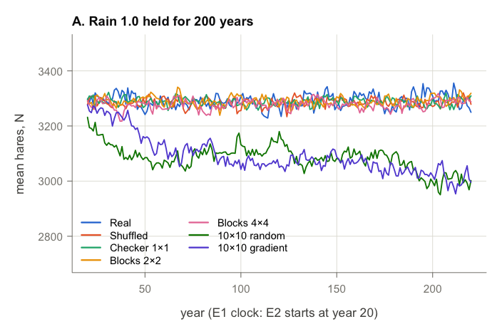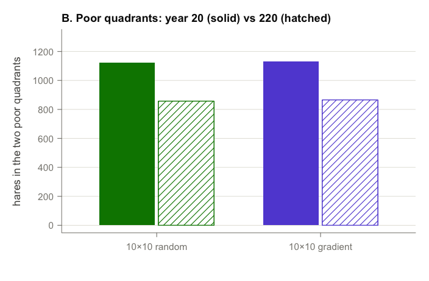

A: mean hares per board. B: hares in the two poor quadrants of the
$10\times 10$ boards at the start and the end.

- **Five boards stay flat for 200 years.**
- **The** $10\times 10$ boards keep draining. Their poor quadrants fall
  from 1,121 to 857 hares (random inside) and from 1,133 to 865
  (gradient), a large drop, while the good quadrants stay put. The whole
  board loses only a small share.
- **Why:** the deterministic board loses the poor quadrants at rain 0.90
  (section 2.2). At rain 1.0 they sit only 0.1 above that fold, just
  above the range where stochasticity kills whole boards (0.06–0.09 in
  E2); a quadrant holds far fewer hares than a board, so stochasticity
  reaches further above its fold. So even in a normal year,
  stochasticity slowly empties poor cells that the neighbours refill too
  rarely.

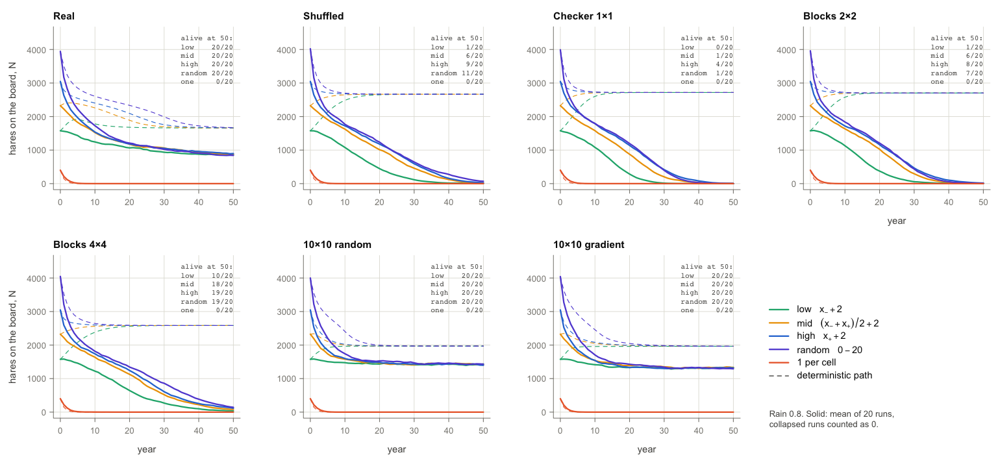

Rain 0.8. Solid: mean of 20 runs, collapsed runs counted as 0. Dashed:
deterministic path. Numbers: runs alive at year 50.

**Rain 0.8.** Each start column gives the runs still alive at year 50,
out of 20. The last two columns give the mean hares at year 50 for the
high start and the deterministic count from the same start.

| Board | low start | mid start | high start | random start | 1 per cell | mean $N$ at year 50 (high start) | deterministic $N$ at year 50 |
|----|----|----|----|----|----|----|----|
| Real | 20 | 20 | 20 | 20 | 0 | 897 | 1663 |
| Shuffled | 1 | 6 | 9 | 11 | 0 | 24 | 2666 |
| Checker $1\times 1$ | 0 | 1 | 4 | 1 | 0 | 2 | 2719 |
| Blocks $2\times 2$ | 1 | 6 | 8 | 7 | 0 | 17 | 2703 |
| Blocks $4\times 4$ | 10 | 18 | 19 | 19 | 0 | 116 | 2584 |
| $10\times 10$ random | 20 | 20 | 20 | 20 | 0 | 1399 | 1970 |
| $10\times 10$ gradient | 20 | 20 | 20 | 20 | 0 | 1316 | 1965 |

- **The deterministic board keeps one settled state at 0.8 on every
  board,** reached from all four starts; rain 0.8 is above every final
  fold.

- **Stochasticity kills the fine boards anyway.** On Shuffled, Checker
  and $2\times 2$ most runs die before year 50. Survival rises with the
  starting total: a head start in a noise-driven decline, not a second
  stable state.

- **Real and the** $10\times 10$ boards survive 50 years from every
  start. The $10\times 10$ boards hold a flat 1,290–1,430 hares; Real
  still loses 4–10 hares a year.

- **1 hare per cell never ignites.**

<a name="s3-4"></a>

### 3.4 Conclusions

> - **The 20-year burn-in at rain 1.0 is safe on every board:** every
>   run reaches the settled band within 10 years. On the $10\times 10$
>   boards the poor quadrants then keep draining slowly for two
>   centuries ($B_r$ holds slightly more hares than the same board 200
>   years later, which is why four of their eight years to forget in the
>   table exceed 20), but this drift does not matter for the start
>   boards: those quadrants empty early at every test rain anyway.
> - Rain 0.8 gives the first sight of E2’s main result: boards that the
>   deterministic model keeps alive die within decades by stochasticity.

<a name="s3-5"></a>

### 3.5 Problems and limitations

> Each board uses one random arrangement of the grass, so part of its
> result may belong to that arrangement rather than to the design
> `(in progress)`.

------------------------------------------------------------------------

<a name="s4"></a>

## 4. E2. Fixed rain: where does each board tip?

<a name="s4-1"></a>

### 4.1 Goal and general idea

Hold the rain fixed and ask which boards keep their hares. The main
number is the tipping rain $\rho_{50}(T)$: the rain at which half the
runs lose every hare within $T$ years. The deterministic fold is the
base; the gap between fold and $\rho_{50}$ is what stochasticity adds.

<a name="s4-2"></a>

### 4.2 Setup

- All seven boards; every run starts from $B_r$ and switches to the test
  rain at year 0.
- Keep the rain constant throughout the run (200 years).
- Rains in three passes: every 0.1 from 0.4 to 1.2 (10 runs), every
  0.025 around the switch (where collapse happens) (20 runs), every
  0.005 inside it (20 runs). Runs alive at year 200 near the switch
  continue to 300.
- Robustness: more runs on Real and Shuffled for 2,000 years.
- Collapse means no hare left. Each run has its own seed; intervals
  bootstrap (resample) over the 20 start boards.

<a name="s4-3"></a>

### 4.3 Results

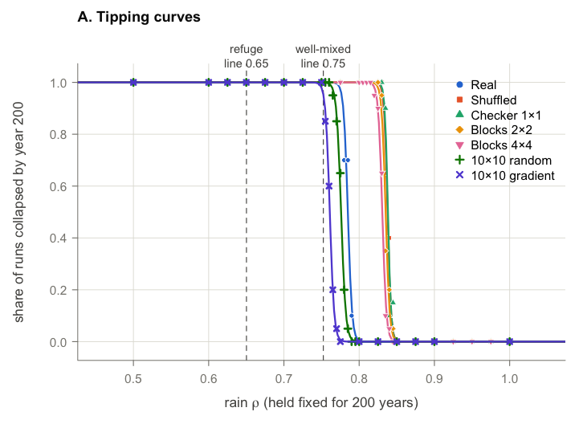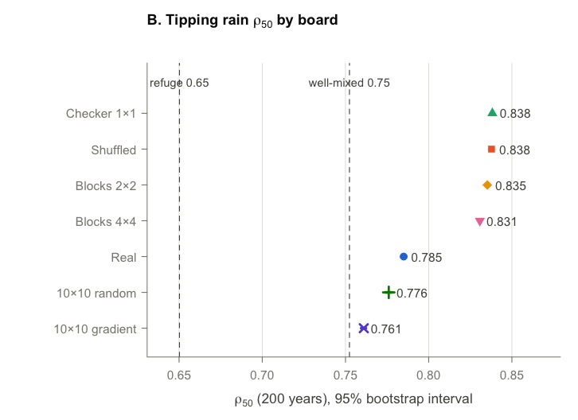

A: share of runs collapsed by year 200 against rain, with logistic fits.
B: $\rho_{50}(200)$ with 95% bootstrap intervals (narrower than the
markers). The dashed “well-mixed” and “refuge” lines are the rough
guesses of the plan (0.498 divided by the mean grass of all cells and of
the better half); section 2.2 gives the real folds.

- **Every board switches from “all survive” to “all die” within about
  0.015 of rain.**
- **Two groups appear.** The fine boards (Shuffled, Checker,
  $2\times 2$, $4\times 4$) tip at 0.831–0.838; the clumped boards
  (Real, $10\times 10$) hold on to 0.761–0.785. Arrangement alone moves
  the tipping rain by about 0.08.

| Board | $\rho_{50}$ 50 yr | 100 yr | 150 yr | 200 yr | 300 yr | deterministic fold | gap at 200 yr |
|----|----|----|----|----|----|----|----|
| Checker $1\times 1$ | 0.802 (0.801–0.822) | 0.829 (0.827–0.830) | 0.834 (0.833–0.835) | 0.838 (0.837–0.840) | 0.841 (0.839–0.842) | 0.752 | +0.087 |
| Shuffled | 0.799 (0.799–0.800) | 0.825 (0.825–0.825) | 0.832 (0.830–0.834) | 0.838 (0.836–0.840) | 0.844 (0.842–0.845) | 0.771 | +0.067 |
| Blocks $2\times 2$ | 0.801 (0.800–0.801) | 0.825 (0.824–0.826) | 0.832 (0.830–0.833) | 0.835 (0.833–0.837) | 0.839 (0.837–0.841) | 0.752 | +0.083 |
| Blocks $4\times 4$ | 0.788 (0.777–0.800) | 0.816 (0.813–0.818) | 0.826 (0.825–0.827) | 0.831 (0.830–0.832) | 0.836 (0.834–0.837) | 0.750 | +0.081 |
| Real | 0.751 (0.750–0.751) | 0.775 (0.773–0.777) | 0.781 (0.779–0.783) | 0.785 (0.783–0.786) | 0.789 (0.788–0.790) | 0.718 | +0.067 |
| $10\times 10$ random | 0.744 (0.741–0.748) | 0.765 (0.763–0.767) | 0.772 (0.771–0.774) | 0.776 (0.774–0.778) | 0.780 (0.779–0.781) | 0.714 | +0.062 |
| $10\times 10$ gradient | 0.727 (0.726–0.738) | 0.752 (0.749–0.754) | 0.758 (0.755–0.759) | 0.761 (0.759–0.762) | 0.765 (0.764–0.766) | 0.702 | +0.059 |


Filled: deterministic final fold. Hollow: $\rho_{50}$ at 200 years.
Number: the gap, the part of tipping that comes from stochasticity.
Ticks: the first fold of the clumped boards.

- **Stochasticity lifts every tipping rain by 0.06–0.09 above the
  fold.** No board lives down to its skeleton.
- **Stochasticity shrinks the differences among the fine boards** (folds
  0.750–0.771; tipping 0.831–0.838) but keeps every fine board above
  every clumped one.

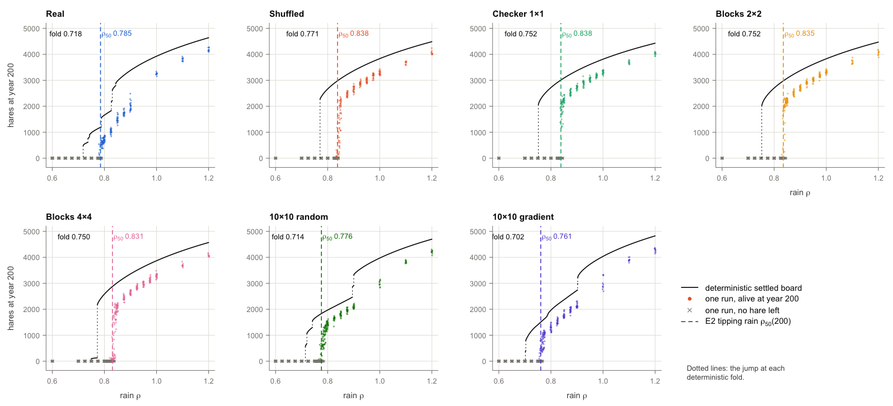

One dot per run: hares at year 200 (grey crosses: no hare left). Black:
the deterministic settled board, with its folds. Dashed:
$\rho_{50}(200)$.

- **The runs sit below the black line at every rain** and fall to zero
  at $\rho_{50}$, where the deterministic board still holds 1,200–3,000
  hares.
- **On the clumped boards, runs near the switch hold a middle level**
  (poor parts empty, good parts full), as the deterministic staircase
  predicts.

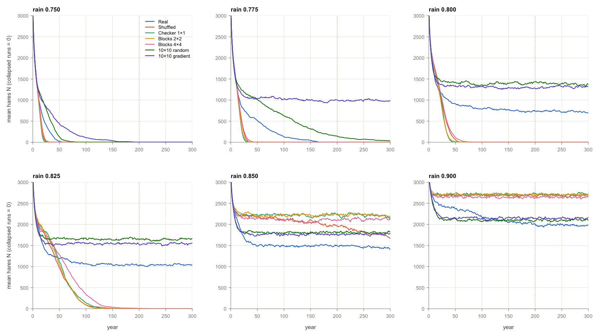

Mean hares over time (collapsed runs counted as 0) for every board at
six rains.

- **At rain 0.80–0.825 the fine boards slide to zero within about 70–150
  years, while the clumped boards hold 700–1,700 hares for centuries.**
  Clumped boards hold fewer hares but keep them.

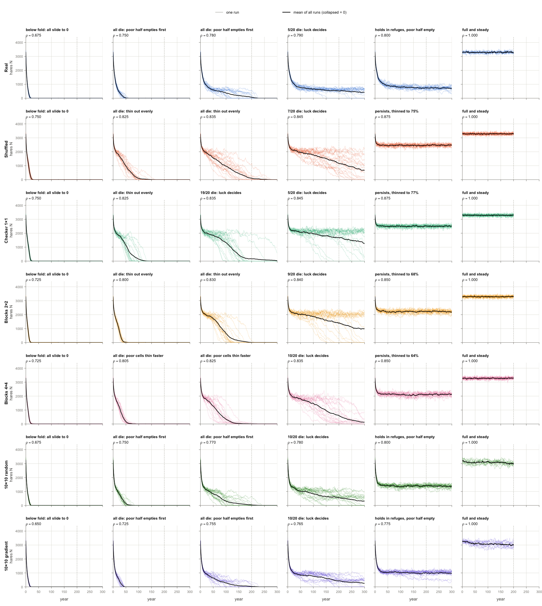

Every run (thin) and the mean (black, collapsed runs = 0) at six rains
per board: 0.10, 0.025 and 0.005 below its $\rho_{50}(200)$, 0.005 and
0.025 above it, and rain 1.0. Each title says what the hares do; counts
are runs dead by the last year shown. Dotted: year 200.

- **The boards differ in how they thin.** Fine boards lose a sizeable
  share of their hares and keep them spread out; clumped boards lose the
  poor half and hold on in refuges.

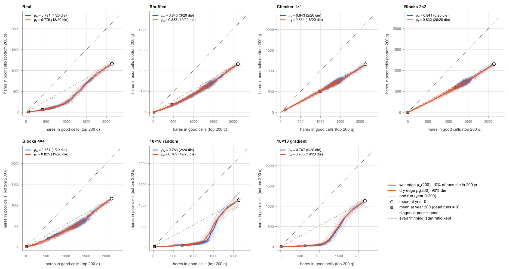

Pullback: hares in the 200 poorest cells against hares in the 200 best,
year 0 to 200. Blue: 20 runs at the wet edge $\rho_w(200)$, where 10% of
runs die within 200 years; orange: 20 runs at the dry edge
$\rho_d(200)$, where 90% die (both from the logistic fit). Bold: mean
path; circle: mean at year 0; square: mean at year 200. Dotted: poor =
good. Dashed: even thinning, the start ratio kept. 280 new runs, saved
year by year.

- **Fine boards thin out evenly.** Shuffled, Checker and $2\times 2$
  slide down the dashed line: the poor cells keep almost the same share
  of the hares at year 50 as at the start.
- **Clumped boards empty the poor half first.** On the $10\times 10$
  boards the path drops almost straight down to the good axis: the poor
  cells keep very few of the hares by year 50. Real does the same less
  sharply; $4\times 4$ sits in between.
- **No path follows the diagonal.** Poor cells always hold fewer hares
  than good ones; the question is whether they keep their share (fine
  boards) or lose it (clumped boards).
- **Wet and dry edges trace the same path** and differ only in how far
  along it the runs get by year 200.

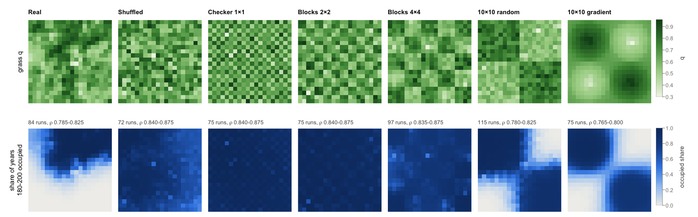

Share of years 180–200 each cell held hares, averaged over surviving
runs just above $\rho_{50}$. Top: grass.

- **The last hares on the Real board live in the grassy north,** the
  same patch where the deterministic board holds out longest (section
  2.3).
- **On the** $10\times 10$ boards the good quadrants are the refuges; on
  fine boards survivors spread evenly.

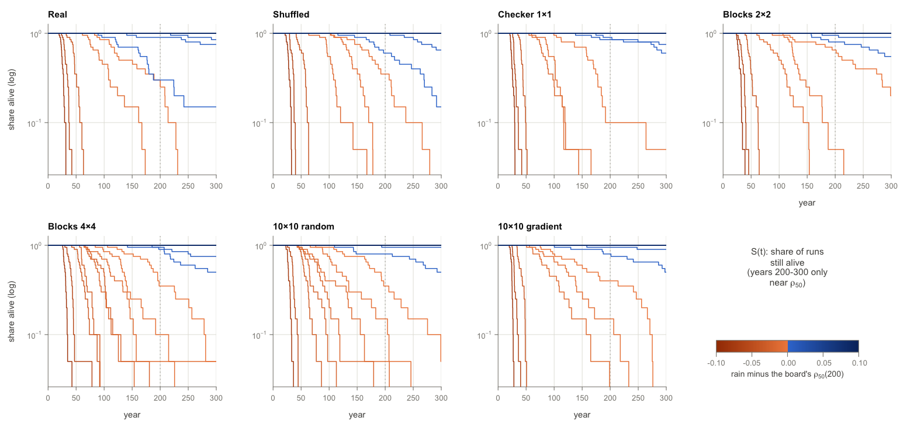

Share of runs alive against year, one curve per rain within 0.1 of
$\rho_{50}$. Orange: drier than $\rho_{50}$; blue: wetter.

- **Below the fold:** every run dies in 10–30 years. The hares simply
  slide to zero (steep cliffs, left).
- **Above the fold:** runs wait for bad luck. Waiting time grows fast
  with rain and varies a lot between runs (slow staircases).
- **Stochasticity speeds up the slide:** just below each fold, runs die
  in 17–29 years; the deterministic board takes 21–141 years (Checker at
  0.75: 24 against 131).

#### Time window vs $\rho_{50}$ vs switch width vs $K$

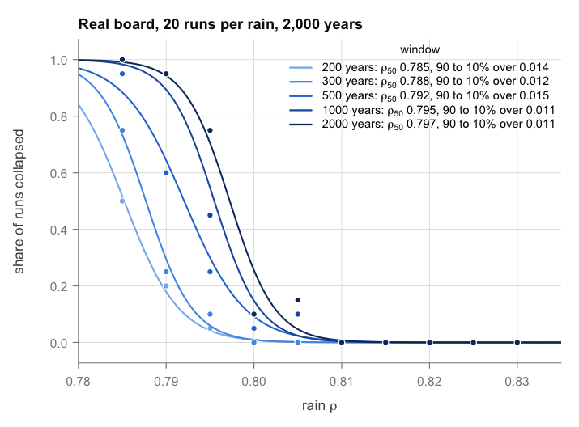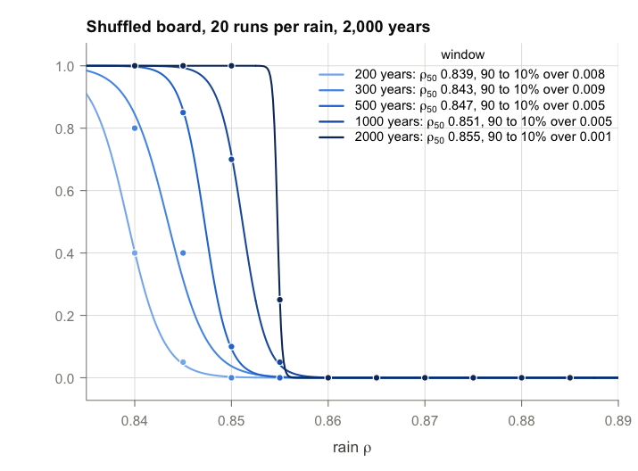

New runs of 2,000 years on Real and Shuffled.

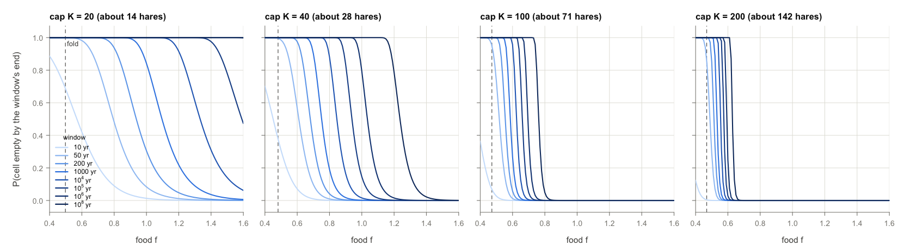

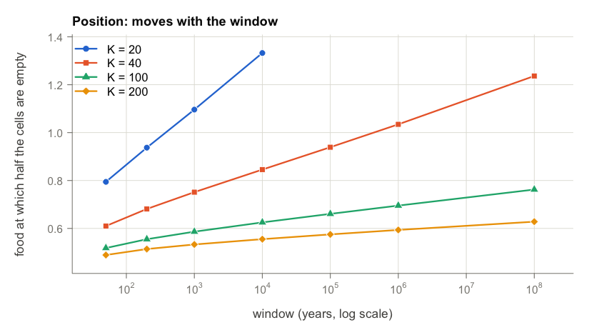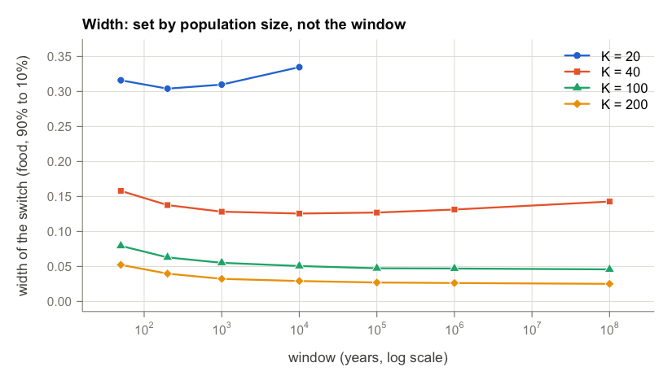

One sealed cell, solved exactly: the chance of being empty after windows
of 10 to $10^8$ years, for cells of about 14, 28, 71 and 142 hares.

- **A longer window moves the switch up, but slowly.** From 200 to 2,000
  years $\rho_{50}$ rises only 0.012 on Real (0.785 $\to$ 0.797) and
  0.016 on Shuffled (0.839 $\to$ 0.855; the separate 2,000-year runs
  give 0.839 at 200 years, against 0.838 in the main runs).
- **The switch stays sharp.** At every window, runs go from “all
  survive” to “all die” within 0.015 of rain.
- **The board ranking never changes.** The lines never cross.
- **Why: the rare-collapse rule**
  - A population of $N$ hares lasts on average about
    $e^{N\cdot S(\rho)}$ years, where $S$ is a barrier per hare that
    grows with rain. (One can interpret it as the depth of a valley in a
    potential diagram.)
  - Half the runs die within $T$ years when that mean life is about $T$,
    so $N\cdot S(\rho_{50}) \approx \ln(T)$.
  - Doubling $T$ adds the same $\ln 2$ each time, so $\rho_{50}$ moves
    by about the same step per doubling, and only slowly.
  - More hares make the switch sharper: in the exact one-cell curves
    (figure above), the switch narrows as the cell holds more hares.
- **The 50-year window breaks this rule.**
  - In the figure, the line from the 50-year to the 100-year window is
    steeper than the line across the longer windows.
  - The steep start comes from a big jump in $\rho_{50}$ between the
    50-year and the 100-year window.
  - The jump happens because $\rho_{50}$ at 50 years sits lower than the
    trend suggests: every run starts full and first spends years
    thinning down, so a 50-year window gives stochasticity too little
    time to act.
  - From 100 years on, stochasticity has enough time, and the slope
    settles to the normal trend.

#### Why do clumped boards give stochasticity less room? (a guess)

*Guess, not tested.* A population lasts roughly $e^{N\cdot S}$ years:
$N$ is the number of hares and $S$ is how deep a valley each hare sits
in. Near tipping, clumped boards hold fewer hares (smaller $N$), but
those hares sit inside big blocks of good grass, where neighbours are
also good and only the block edges leak hares into poor land, so $S$
should be large. Fine boards hold more hares, but every good cell
touches poor cells that keep draining it, so the whole board sits in one
shallow valley and $S$ should be small. If $S$ outweighs $N$, clumped
boards last longer and tip closer to their fold, as E2 shows.

<a name="s4-4"></a>

### 4.4 Conclusions

- **Stochasticity tips every board above its fold.** Boards die
  0.06–0.09 of rain above the rain where their settled state vanishes.
- **Tipping is sharp in rain.** Within about 0.015 of rain, runs switch
  from “all survive” to “all die”, because each board holds thousands of
  hares.
- **A longer time window moves the tipping rain only slowly.**
  $\rho_{50}$ grows with the logarithm of the window: going from 200 to
  2,000 years adds only 0.012–0.016.
- **Arrangement moves the tipping rain by about 0.08.** Clumped boards
  keep their good blocks as refuges and tip lowest (0.761–0.785); fine
  boards tip at 0.831–0.838.
- **Fine and clumped boards thin out differently.** Fine boards thin out
  evenly; clumped boards lose their poor half first.

<a name="s4-5"></a>

### 4.5 Problems and limitations

- **All rains share the same 20 start boards:** we resample those boards
  200 times (bootstrap) so that one lucky or unlucky start board cannot
  set $\rho_{50}$; the intervals in the table come from this.
- $\rho_{50}$ **depends on the window:** it moves up slowly as the
  window grows, so we compare boards at one window (200 years) and use
  the fold as the window-free reference.
- **Collapse means the last hare dies.** A “10% left” line would place
  the switch slightly higher, but it fails on the Real board: Real loses
  its poor half early and then holds only a small share of its hares for
  centuries, so a 10% line would sit too close to that thinned but alive
  state and mix thinning with dying.

------------------------------------------------------------------------

<a name="s5"></a>

## 5. E3. Falling rain: does the speed of the drought matter?

<a name="s5-1"></a>

### 5.1 Goal and general idea

Let the rain fall steadily and record the rain at which each board
collapses. Two effects compete. **Lag:** hares need years to decline to
the level the current rain supports, so a fast drought outruns them and
they collapse at a lower rain. **Stochasticity:** a slow drought gives
bad luck more time at each rain, so collapse moves up toward E2’s
tipping rain. The deterministic board on the same ramps shows the lag
alone.

<a name="s5-2"></a>

### 5.2 Setup

- All seven boards, 20 runs each from $B_1, \dots, B_{20}$.
- Rain falls in a straight line from 1.0 to 0.4 over 50, 150, 450, 1,350
  or 4,050 years (each 3 times slower), then stays at 0.4 for up to 50
  years.
- Rain changes in monthly steps; the simulator stops its clock at each
  step and stays exact (section 1.6).
- Collapse rain: the rain when $N$ first falls below 10% of its start.
  The last hare dies years later, while the rain keeps falling, so we
  report it separately.
- Saved: $N$ every month, the board every 0.005 of rain, the last hare.

<a name="s5-3"></a>

### 5.3 Results

**Deterministic collapse rain (dashed black line).** We start the
averaged equations (no stochasticity) settled at rain 1.0, lower the
rain along the same ramp, and read the rain when $N$ first drops below
10% of its start. This shows lag alone. Example (Shuffled, fold 0.771):
0.754 on the 4,050-year ramp, 0.608 on the 50-year ramp.


Dots: single runs; coloured line: their mean. Dashed black: the
deterministic board on the same ramp. Dotted black: the deterministic
fold. Dash-dot: E2’s $\rho_{50}(200)$.

| Board | 50 yr | 150 yr | 450 yr | 1,350 yr | 4,050 yr | E2 $\rho_{50}(200)$ | fold |
|----|----|----|----|----|----|----|----|
| Real | 0.637 ($\pm 0.011$; deterministic 0.588) | 0.706 ($\pm 0.008$; deterministic 0.653) | 0.744 ($\pm 0.009$; deterministic 0.686) | 0.763 ($\pm 0.005$; deterministic 0.703) | 0.779 ($\pm 0.007$; deterministic 0.710) | 0.785 | 0.718 |
| Shuffled | 0.656 ($\pm 0.007$; deterministic 0.608) | 0.736 ($\pm 0.010$; deterministic 0.679) | 0.783 ($\pm 0.005$; deterministic 0.718) | 0.808 ($\pm 0.005$; deterministic 0.740) | 0.826 ($\pm 0.004$; deterministic 0.754) | 0.838 | 0.771 |
| Checker $1\times 1$ | 0.661 ($\pm 0.006$; deterministic 0.610) | 0.741 ($\pm 0.007$; deterministic 0.679) | 0.785 ($\pm 0.006$; deterministic 0.714) | 0.812 ($\pm 0.004$; deterministic 0.732) | 0.828 ($\pm 0.004$; deterministic 0.742) | 0.838 | 0.752 |
| Blocks $2\times 2$ | 0.657 ($\pm 0.007$; deterministic 0.610) | 0.742 ($\pm 0.007$; deterministic 0.680) | 0.785 ($\pm 0.006$; deterministic 0.716) | 0.810 ($\pm 0.005$; deterministic 0.734) | 0.825 ($\pm 0.003$; deterministic 0.743) | 0.835 | 0.752 |
| Blocks $4\times 4$ | 0.653 ($\pm 0.009$; deterministic 0.609) | 0.738 ($\pm 0.005$; deterministic 0.682) | 0.782 ($\pm 0.006$; deterministic 0.721) | 0.806 ($\pm 0.004$; deterministic 0.743) | 0.823 ($\pm 0.004$; deterministic 0.757) | 0.831 | 0.750 |
| $10\times 10$ random | 0.621 ($\pm 0.011$; deterministic 0.571) | 0.692 ($\pm 0.006$; deterministic 0.637) | 0.730 ($\pm 0.006$; deterministic 0.674) | 0.756 ($\pm 0.005$; deterministic 0.695) | 0.769 ($\pm 0.007$; deterministic 0.705) | 0.776 | 0.714 |
| $10\times 10$ gradient | 0.610 ($\pm 0.011$; deterministic 0.569) | 0.687 ($\pm 0.006$; deterministic 0.635) | 0.721 ($\pm 0.007$; deterministic 0.669) | 0.743 ($\pm 0.005$; deterministic 0.686) | 0.752 ($\pm 0.003$; deterministic 0.695) | 0.761 | 0.702 |

- **Collapse rain rises with ramp length on every board.** Shuffled
  collapses at 0.656 on the 50-year ramp and at 0.826 on the 4,050-year
  ramp; Real at 0.637 and 0.779.
- **Fast droughts carry boards far below their fold;** slow droughts
  approach E2. The measured collapse rain crosses the deterministic fold
  between the 150- and 450-year ramps on every board. On the slowest
  ramp it sits 0.006–0.012 below E2’s $\rho_{50}(200)$.
- **Simulated boards collapse at a wetter rain than the deterministic
  board on every ramp:** 0.04–0.05 of rain higher on the 50-year ramp
  and 0.06–0.09 on the 4,050-year ramp. We call this gap stochasticity,
  but it holds two things we have not yet separated.
  - *A part present at every speed.* At $K = 20$ the averaged equations
    hold more hares than the simulator, and below the fold, where no
    settled state exists, E2’s runs empty faster than the deterministic
    board (median 17–29 years against 21–141). So runs sit wetter than
    the deterministic board even when a fast drought leaves no time to
    wait.
  - *A part that grows with time.* The gap widens as the ramp slows.
    This fits waiting for a rare run of bad luck: a slow drought keeps
    the board above its fold for longer, so stochasticity has more time
    to strike.
  - *Not yet tested:* how much each part contributes. A deterministic
    run with a larger $K$, where the averaged equations become exact,
    would separate them.
- **Runs agree closely:** the spread between runs is only 0.003–0.011 of
  rain.
- **The ranking of E2 holds at every speed.** Measured by the last hare,
  the event E2 counts, the gap between Shuffled and $10\times 10$ random
  grows from 0.037 on the 50-year ramp to 0.059 on the 4,050-year ramp,
  against 0.062 in E2. The 10% rule gives nearly the same gaps (0.035 to
  0.057). Lag partly hides the effect of arrangement.
- **The last hare comes much later on fast ramps.** On the 50-year ramp
  it dies about 0.1 of rain below the 10% point (8–10 years later); on
  the slowest ramp the difference is under 0.01.

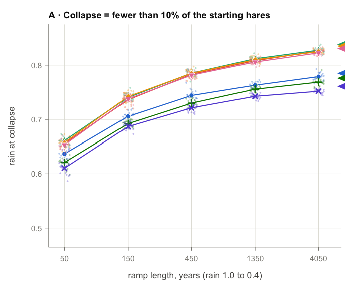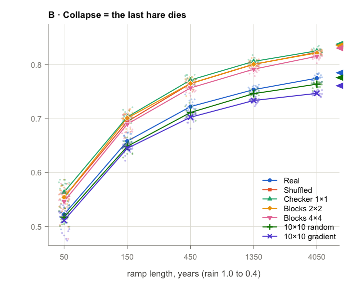

The same 700 runs measured two ways. A: the rain when fewer than 10% of
the starting hares remain. B: the rain when the last hare dies. Arrows:
E2’s $\rho_{50}(200)$.

- **Slow droughts: the two rules agree.** On the 4,050-year ramp they
  differ by under 0.01 of rain, and both sit just below E2’s
  $\rho_{50}(200)$.
- **Fast droughts: the last-hare rule reads about 0.1 lower,** because
  the rain keeps falling while the last hares die out (lag).
- **The board ranking and the rise with ramp length hold under both
  rules,** so the 10% rule changes the numbers, not the conclusions.

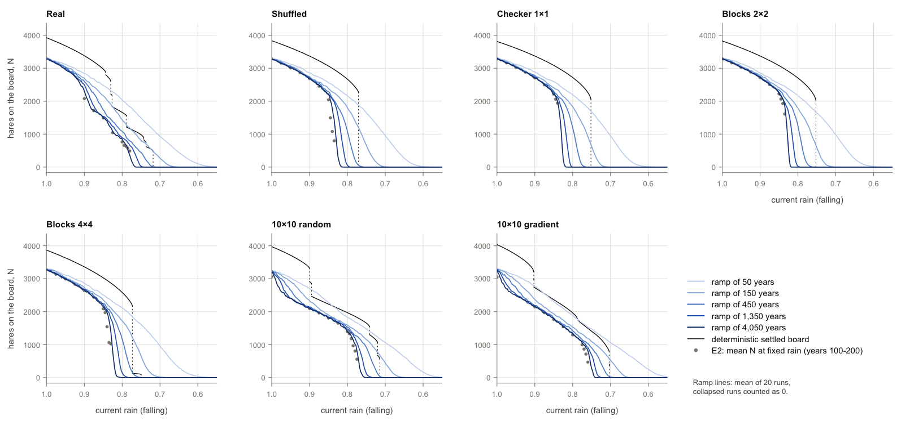

Mean hares against the current rain for each speed (light: fast, dark:
slow). Black: the deterministic settled board. Grey dots: E2’s mean
hares at fixed rain.

- **The slow ramps follow E2’s fixed-rain levels** (grey dots) and then
  drop at E2’s switch. The fast ramps stay above them: the lag is
  visible.
- **The clumped boards fall in steps on slow ramps,** poor parts first,
  as the deterministic staircase predicts.

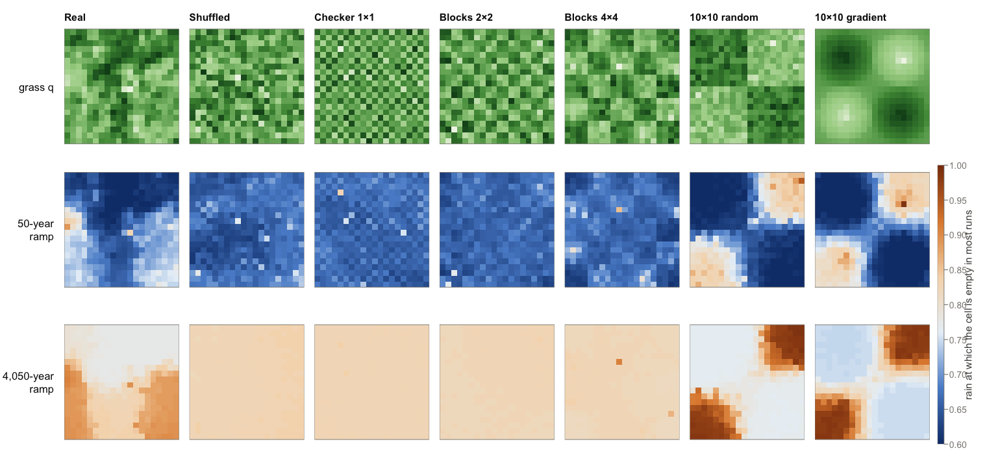

Rain at which each cell is empty in more than half the runs (from boards
saved every 0.005 of rain). Brown: empties early; blue: holds out.

- **On the slowest ramp the** $10\times 10$ poor quadrants empty near
  rain 0.90 (medians 0.903 and 0.895), where the deterministic board
  loses them, and the good quadrants hold to 0.75–0.77. On the 50-year
  ramp everything happens lower (poor quadrants about 0.79, good about
  0.60).
- **Real empties from the south** (median 0.875 on the slow ramp) and
  keeps its north longest (0.775). Fine boards empty almost everywhere
  at once.

<a name="s5-4"></a>

### 5.4 Conclusions

- “The” tipping point is a curve against drought speed: lag sets it for
  fast droughts, stochasticity for slow ones, and the two balance at
  ramps of 150–450 years.
- E2’s fixed-rain tipping rain is the slow-drought limit: on the slowest
  ramp boards collapse 0.006–0.012 below it.
- The effect of arrangement survives every speed.

<a name="s5-5"></a>

### 5.5 Problems and limitations

- Linearly decreasing droughts only, and only the way down. Drought
  shape and a ramp back up: to-do.

------------------------------------------------------------------------

<a name="s6"></a>

## 6. E4. Coming back: how big must a released colony be?

<a name="s6-1"></a>

### 6.1 Goal and general idea

After a collapse the board stays empty, because an empty cell makes no
hares. A released group must beat two losses: partners are scarce at low
numbers (the Allee effect), and each hare tries to hop about 10 times a
year, so a group spreads out faster than it breeds. E4 asks how big a
colony must be to re-found the population, how that size changes with
rain, and whether one big colony beats several small ones of the same
total.

<a name="s6-2"></a>

### 6.2 Setup

- Real board, empty apart from the colony. A colony is a $k\times k$
  square of cells with 14 hares each (about the settled count of a good
  cell at rain 1.0), placed where the mean grass over the square is
  highest.
- Arm A, colony size: $k = 1, 2, 3, 4, 5, 6$ or $8$ (14 to 896 hares).
- Arm B, one big or several small: 224 hares as one $4\times 4$ colony,
  four $2\times 2$ colonies (best spot in each quadrant), or sixteen
  single cells (best cell in each $5\times 5$ part).
- Rains 1.0, 0.9, 0.85 and 0.785 (Real’s $\rho_{50}$ at 200 years). 50
  runs $\times$ 50 years each: 2,000 runs. Success: hares alive at year
  50. 

<a name="s6-3"></a>

### 6.3 Results

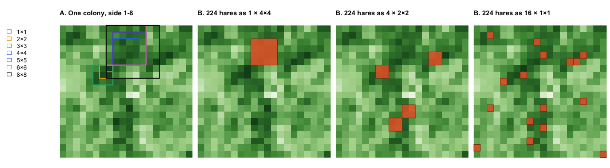

Where the colonies go. A: the best $k\times k$ square for each size, all
in the grassy north. B: the three designs of 224 hares.


Share of runs alive at year 50 against colony size.

| Runs alive at 50 (of 50) | $1\times 1$ (14 hares) | $2\times 2$ (56 hares) | $3\times 3$ (126 hares) | $4\times 4$ (224 hares) | $5\times 5$ (350 hares) | $6\times 6$ (504 hares) | $8\times 8$ (896 hares) | smallest colony, $\ge$ half alive |
|----|----|----|----|----|----|----|----|----|
| rain 1 | 0 | 42 | 50 | 50 | 50 | 50 | 50 | $2\times 2$ |
| rain 0.9 | 0 | 6 | 37 | 50 | 50 | 50 | 50 | $3\times 3$ |
| rain 0.85 | 0 | 0 | 5 | 45 | 50 | 50 | 50 | $4\times 4$ |
| rain 0.785 | 0 | 0 | 0 | 2 | 7 | 20 | 44 | $8\times 8$ |

- **A single cell never takes hold**, even full and on the best grass (0
  of 200 runs): its hares hop out faster than they breed.
- **The minimum colony grows as rain falls:** $2\times 2$ (56 hares) at
  rain 1.0, $3\times 3$ (126) at 0.9, $4\times 4$ (224) at 0.85, and
  $8\times 8$ (896) at 0.785.
- **Coming back is harder than staying.** At rain 0.85 a full Real board
  survives 200 years in every E2 run, yet a colony needs 224 hares
  packed into 16 cells to come back.


224 hares as one $4\times 4$ colony, four $2\times 2$ colonies or
sixteen single cells.

| 224 hares as | one $4\times 4$ | four $2\times 2$ | sixteen $1\times 1$ |
|----|----|----|----|
| rain 1 | 50 | 50 | 33 |
| rain 0.9 | 50 | 25 | 4 |
| rain 0.85 | 49 | 0 | 0 |
| rain 0.785 | 1 | 0 | 0 |
| mean grass of the cells | 0.833 | 0.864 | 0.880 |

- **One big colony does at least as well as several small ones at every
  rain, and far better as rain falls:** at 0.85, 49 of 50 runs against 0
  and 0.
- **Site quality is not the reason.** The sixteen single cells sit on
  the best grass (mean $q$ 0.880, against 0.833 for the $4\times 4$
  colony) and still do worst.

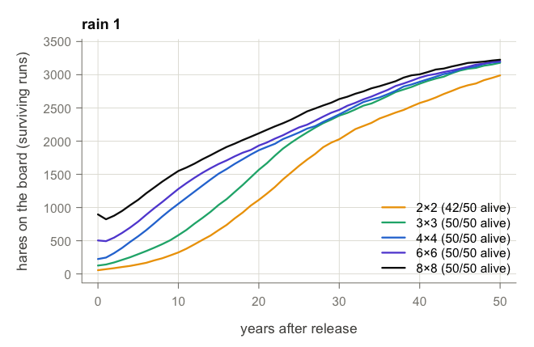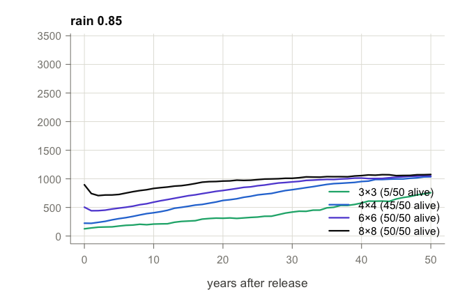

Mean hares of the surviving runs after release.

- **At rain 1.0 a successful colony refills the board within 50 years:**
  2,990–3,230 hares on 384–397 occupied cells, close to the settled
  3,293.
- **At 0.85 colonies grow slowly:** about 1,040–1,080 hares on 190 cells
  at year 50, still below the 1,490 hares a full Real board keeps at
  this rain in E2.

<a name="s6-4"></a>

### 6.4 Conclusions

- Released hares need a compact colony wider than their reach; its
  minimum size rises steeply as rain falls, fastest near the tipping
  rain.
- Keep released hares together: one big colony beats several small ones
  of the same total.
- The best release site is the same grassy north that keeps the last
  hares in E2 and E3.

<a name="s6-5"></a>

### 6.5 Problems and limitations

- 14 hares per cell at every rain, so dry-year colonies start above
  their settled count and first shrink.
- The best square moves with its size, so size and site quality change
  together (mean grass from 0.962 for one cell to 0.758 for
  $8\times 8$).
- A colony alive at year 50 near the tipping rain may still die later.
  One map; closed edges.

<a name="ch3"></a>

# Chapter 3: Conclusions

<a name="s7"></a>

## 7. Final verdict

1.  **Without stochasticity, each board holds on until a clear breaking
    point.** The averaged equations keep a steady population on every
    board until the rain falls to its fold, between 0.70 and 0.77.
    Rearranging the same grass shifts this fold by up to 0.07. Shuffled,
    Checker and $2\times 2$ break all at once; Real and the
    $10\times 10$ boards break in steps, losing their poor parts first
    and holding on in their good blocks.
2.  **Stochasticity kills populations long before the skeleton fails.**
    At fixed rain every board dies 0.06–0.09 above its fold. The switch
    is sharp, because a board holds thousands of hares, and a longer
    wait moves it only slowly. How much stochasticity adds depends on
    the arrangement: most on Checker and $2\times 2$ (0.083–0.087).
3.  **The speed of a drought decides which effect wins.** Fast droughts
    outrun the hares (lag), slow ones give stochasticity time; they
    balance at ramps of 150–450 years. On the slowest drought, boards
    collapse just below E2’s fixed-rain tipping rain (0.006–0.012
    lower).
4.  **Coming back is much harder than staying.** A released colony must
    be a compact block, from $2\times 2$ cells at normal rain to
    $8\times 8$ at the tipping rain, and one big colony beats several
    small ones.
5.  **Arrangement matters the same way everywhere.** Large clumps of
    good grass (the Real board’s north, the good $10\times 10$
    quadrants) lower the collapse rain by 0.05–0.08, keep the last hares
    and give the best release sites.
6.  **The equations give the breaking points; stochasticity brings the
    collapse forward.** The averaged equations find each board’s folds
    and show how a fast drought carries a board below them before the
    hares can respond (lag). Stochasticity makes every board die sooner:
    at fixed rain it dies 0.06–0.09 above its fold, and just below the
    fold it empties in 17–29 years instead of 21–141.

<a name="s8"></a>

## 8. Further directions

1.  **Movement settings.** The deterministic sweep puts $m = 10$ near
    the worst hop rate. Run E2’s fixed-rain design at $m = 3, 10, 30$
    (and $\alpha = 0$ and $2$) on Shuffled and Real.
2.  **Population size.** Rerun E2 with $K = 40$ and $80$ to test whether
    the gap between boards survives bigger populations, and compute the
    valley depth $S$ per board to test the guess in section 4.3.
3.  **Rain back up.** From E3’s partly collapsed boards, raise the rain
    again: how fast do refuges refill the board, and at what rain? E4
    already shows that an empty board does not refill on its own.
4.  **Early warning signals.** E3 saved monthly $N$ and boards every
    0.005 of rain. Test variance, autocorrelation and Moran’s I on the
    slow ramps, against the recovery time the deterministic board
    predicts (section 2.4).
5.  **The slow drain of poor regions.** E1 found poor quadrants losing
    hares at rain 1.0 for two centuries. Measure this decline on
    purpose: it is tipping by stochasticity on a sub-population.
6.  **Realistic releases.** Add post-release dispersal and a settling
    period, repeated small releases, and stepping-stone designs.
7.  **Drought shape and random rain years**, a second random draw of
    each board, a larger window with open edges, and theory for the
    board’s barrier (WKB) and for recovery fronts.

**Files.** Every function, run file, result table and check sits in this
folder; section 9 lists them.

**References.** Gillespie (1976) J. Comput. Phys.; Gillespie (1977) J.
Phys. Chem.; Kurtz (1970) J. Appl. Prob.; van Kampen, Stochastic
Processes in Physics and Chemistry; Freidlin & Wentzell, Random
Perturbations of Dynamical Systems; Ovaskainen & Meerson (2010) Trends
Ecol. Evol.; Scheffer et al. (2009) Nature. Check each before citing.

------------------------------------------------------------------------

<a name="app"></a>

# Appendix

<a name="s9"></a>

## 9. The code in this folder

Base R only (R 4.1 or newer), plus one optional C file that makes the
simulations about 100 times faster. Run everything from this folder.

``` r
source("Load.R")                 # read every function file
deterministic_fold_plot_2()      # any nickname draws one figure
source("checks/Run_checks.R")    # 28 checks in about a minute; each says PASS
```

| Folder or file | What it holds |
|----|----|
| `Load.R` | reads every function file below |
| `R/Params.R` | `Set_params()`: the six parameters, with range checks (section 1.1) |
| `R/Map.R` | the grid, neighbours and crossing chances; the seven boards (sections 1.2, 2.2) |
| `R/Rates.R` | birth, death and hop rates of one cell (section 1.1) |
| `R/Rho.R` | rain: fixed, or falling along a line in monthly steps (E3) |
| `R/Simulate.R` | the Gillespie simulator in plain R: `Run_sim()`, `Run_many()` (section 1.6) |
| `R/Engine.R`, `src/hh_engine.c` | the same simulator in C, compiled once and loaded on first use |
| `R/Deterministic.R` | the averaged equations: Newton’s method, eigenvalues, continuation, folds (sections 1.5, 2) |
| `R/Measure.R` | the one-cell fold, exact answers from the master equation, tipping-curve fits, bootstrap, Kaplan-Meier (sections 1.4, 2.1, 4) |
| `R/Results.R` | reads the saved results |
| `plots/` | one file per section: figure functions (`Plot_...`) and their nicknames |
| `run/` | one file per experiment: reruns it and rewrites its result tables |
| `checks/` | `Checks.R` (the tests) and `Run_checks.R` (runs them all) |
| `data/` | the Mayureshwar grass grid and the seven boards |
| `results/` | every number the figures draw, as CSV tables |
| `figs/` | the model picture and the build chart (used above, with its LaTeX source `build_chart.tex`), and the outcome page’s figures as images |

**Figures.** Each figure has a one-line nickname that draws it with no
input; `REPORT.Rmd` and `README.Rmd` call them.

| Section | Nicknames |
|----|----|
| 2.1 | `deterministic_one_cell_plot_1()`, `deterministic_one_cell_plot_2()` |
| 1.2 | `boards_plot()` |
| 2.2 | `deterministic_fold_plot_1()`, `deterministic_fold_plot_2()` |
| 2.3 | `deterministic_staircase_plot()` |
| 2.4 | `deterministic_recovery_plot()` |
| 2.5 | `deterministic_hop_plot()` |
| 3 (E1) | `E1_runs_plot()`, `E1_start_plot()`, `E1_drift_plot_1()`, `E1_drift_plot_2()`, `E1_dry_plot()` |
| 4 (E2) | `E2_tipping_plot_1()`, `E2_tipping_plot_2()`, `E2_fold_gap_plot()`, `E2_hares_vs_det_plot()`, `E2_mean_N_plot()`, `E2_story_plot()`, `E2_pullback_plot()`, `E2_refuge_plot()`, `E2_survival_plot()`, `E2_window_plot()`, `E2_long_plot_1()`, `E2_long_plot_2()`, `E2_theory_plot_1()`, `E2_theory_plot_2()`, `E2_theory_plot_3()` |
| 5 (E3) | `E3_collapse_plot()`, `E3_threshold_plot_1()`, `E3_threshold_plot_2()`, `E3_N_vs_rain_plot()`, `E3_empty_first_plot()` |
| 6 (E4) | `E4_sites_plot()`, `E4_size_plot()`, `E4_designs_plot()`, `E4_growth_plot_1()`, `E4_growth_plot_2()` |

**Rerunning the experiments.** Each file in `run/` starts with
`quick = TRUE`: a small version that writes to `results_quick/` (draw
its figures after `options(hh.results = "results_quick")`). Set
`quick = FALSE` for the full design, which rewrites `results/`. The
simulations need the C engine for full runs (a C compiler: Rtools on
Windows, the Xcode command line tools on a Mac): E1 takes about 6
minutes, E2 about 1.5 hours, E3 about 30 minutes and E4 about 3 minutes;
the deterministic board (`run/Run_deterministic.R`, no simulation) takes
about 30 minutes. Run E1 before E2 and E3: they start from its boards.

------------------------------------------------------------------------

<a name="s10"></a>

## 10. AI use

I built this project with Claude, an AI assistant made by Anthropic.

- **Model and code.** I designed the model, its rules and the logic of
  the simulation, and wrote the first R simulator and the theory
  derivations. Claude refined my R code and wrote the C engine, most of
  the plotting code, the structure of the repository and most code
  comments. I checked the R code step by step. The C engine reproduces
  the R simulator run for run, and `checks/Run_checks.R` tests the
  simulator against exact answers.
- **Experiments.** I designed most of the experiments and ran many
  trial-and-error simulations to finalise them; AI assisted with some of
  these runs and most of the trial plots.
- **Analysis and text.** AI assisted with the data analysis. I accepted
  a result only after verifying it in the graphs and cross-checking
  samples against the files in `results/`. I wrote the theory and edited
  the whole report by hand; parts of the result text began as AI drafts,
  which I checked and rewrote where needed. AI also proofread the
  report. The README is an AI-generated summary of the report, polished
  by hand.

Errors may remain; they are mine to fix, and I welcome corrections.

------------------------------------------------------------------------
